# EduERP v2.0 — Ma’lumotlar Modeli, ER Diagramma, Cheklovlar va Proyeksiyalar (`docs/architecture/data-model.md`)

- **Task / Step ID:** `S02FIX-S03FULL-E` / Step `02.02` (`T02.02` — `S2F03`, `S2F04`, `S2F07` tuzatishlari bilan yangilangan tahrir)
- **Base Commit:** `4a9ba11baf08460579d80f262b5c65b6ad64a6d1`
- **Asosiy manbalar:** `planning/03_ARCHITECTURE.md`, `planning/05_DOMAIN_RULES.md`, `planning/07_SECURITY_AND_RELEASE.md`, `docs/spec/business-rules.md` (`BR-01`–`BR-18`, `C03`, `C04`), `docs/spec/decisions.md` (`D07`, `D08`, `D11`, `D14`, `D19`, `D21`, `D22`), `planning/state/reviews/S01-S02-D.md`.
- **Hujjat maqomi:** `IN_REVIEW` (Stage 02 ma’lumotlar modeli spetsifikatsiyasi; ushbu bosqichda bajariladigan SQL migratsiya yoki ORM kodi yozilmaydi — migratsiyalar Stage 04 da yaratiladi).

---

## 1. Yaxlit Entity-Relationship (`ER`) Diagrammasi (`T02.02`, `S2F03`, `S2F04`)

Quyidagi Mermaid ER diagrammasi ko‘p guruhli `Enrollment`, ko‘p farzandli va ko‘p vasiyli `GuardianStudent` (`M:N`), bir kunda bir nechta darsni qo‘llovchi `LessonOccurrence`, `BillingCycle` (`C04`), `TrialActivation` (`C04` reactivation bilan), hamda **mutable so‘rov/tasdiq** (`DiscountRequest`, `ReversalOrRefundRequest`) va **qat’iy o‘zgarmas (`append-only`) moliyaviy ijro/kompensatsiya** (`Payment`, `PaymentAllocation`, `PaymentAllocationReversal`, `ReversalOrRefundExecution`, `CreditNote`, `CreditNoteApplication`, `LedgerEntry`, `OutboxConsumerReceipt`) bog‘lanishlarini ifodalaydi:

```mermaid
erDiagram
  CENTER_LICENSE ||--o{ AUDIT_LOG : "audited_in"
  STAFF_USER ||--o{ STAFF_SESSION : "has_sessions"
  STAFF_USER ||--o{ COURSE_GROUP : "primary_teacher"
  STAFF_USER ||--o{ SUBSTITUTE_ASSIGNMENT : "substitute_teacher"
  STAFF_USER ||--o{ CASH_SHIFT : "opened_closed_by"
  STAFF_USER ||--o{ PAYROLL_SNAPSHOT : "earns_payroll"

  STUDENT ||--o{ GUARDIAN_STUDENT : "has_guardians"
  GUARDIAN ||--o{ GUARDIAN_STUDENT : "cares_for_children"
  GUARDIAN ||--o{ GUARDIAN_TELEGRAM_LINK : "links_telegram"

  COURSE ||--o{ COURSE_PRICE_HISTORY : "has_price_history"
  COURSE ||--o{ COURSE_GROUP : "instantiates"
  COURSE_GROUP ||--o{ ENROLLMENT : "enrolls_students"
  STUDENT ||--o{ ENROLLMENT : "enrolled_in_groups"

  COURSE_GROUP ||--o{ LESSON_OCCURRENCE : "schedules_lessons"
  LESSON_OCCURRENCE ||--o| SUBSTITUTE_ASSIGNMENT : "has_1day_substitute"
  LESSON_OCCURRENCE ||--o{ ATTENDANCE_RECORD : "records_attendance"
  STUDENT ||--o{ ATTENDANCE_RECORD : "attends_lesson"
  ATTENDANCE_RECORD ||--o{ ATTENDANCE_REVISION : "has_history"
  LESSON_OCCURRENCE ||--o{ GRADE_ENTRY : "records_grades"

  BILLING_POLICY_VERSION ||--o{ BILLING_CYCLE : "governs"
  ENROLLMENT ||--o{ TRIAL_ACTIVATION : "tracks_trial_activations"
  ENROLLMENT ||--o{ BILLING_CYCLE : "has_billing_cycles"
  BILLING_CYCLE ||--|| INVOICE : "generates_unique_invoice"
  INVOICE ||--o{ INVOICE_LINE : "contains_lines"
  INVOICE ||--o{ DISCOUNT_REQUEST : "targets_discount"
  DISCOUNT_REQUEST ||--o| DISCOUNT_APPROVAL : "approved_by_director"
  ENROLLMENT ||--o{ FREEZE_RECORD : "freezes_lessons"
  FREEZE_RECORD ||--o{ FREEZE_LESSON_LINK : "locks_unique_lesson"
  FREEZE_RECORD ||--o| CREDIT_NOTE : "issues_next_cycle_credit"
  CREDIT_NOTE ||--o{ CREDIT_NOTE_APPLICATION : "applied_via"
  UNAPPLIED_CREDIT ||--o{ CREDIT_NOTE_APPLICATION : "applied_via"
  INVOICE ||--o{ CREDIT_NOTE_APPLICATION : "receives_credit_application"

  CASH_SHIFT ||--o{ PAYMENT : "collects_cash_in_shift"
  CASH_SHIFT ||--o{ CASH_EXPENSE : "spends_cash_in_shift"
  STUDENT ||--o{ PAYMENT : "makes_payment"
  PAYMENT ||--o{ PAYMENT_ALLOCATION : "allocates_to_invoices"
  INVOICE ||--o{ PAYMENT_ALLOCATION : "paid_by_allocations"
  PAYMENT_ALLOCATION ||--o{ PAYMENT_ALLOCATION_REVERSAL : "reversed_by_movement"
  PAYMENT ||--o| UNAPPLIED_CREDIT : "leaves_overpayment_credit"
  PAYMENT ||--o{ REVERSAL_OR_REFUND_REQUEST : "requested_for_reversal"
  REVERSAL_OR_REFUND_REQUEST ||--o| REVERSAL_OR_REFUND_EXECUTION : "executed_immutably"
  REVERSAL_OR_REFUND_EXECUTION ||--o{ PAYMENT_ALLOCATION_REVERSAL : "creates_allocation_reversals"
  PAYMENT ||--|| RECEIPT : "issues_receipt"
  INVOICE ||--o{ PROMISE_TO_PAY : "tracks_debt_promise"

  PAYMENT ||--o{ LEDGER_ENTRY : "posts_immutable_ledger"
  REVERSAL_OR_REFUND_EXECUTION ||--o{ LEDGER_ENTRY : "posts_reversal_ledger"
  CASH_EXPENSE ||--o{ LEDGER_ENTRY : "posts_expense_ledger"
  CREDIT_NOTE ||--o{ LEDGER_ENTRY : "posts_credit_ledger"

  PAYROLL_SNAPSHOT ||--o{ PAYROLL_ADJUSTMENT : "adjusted_in_future_period"
  OUTBOX_EVENT ||--o{ OUTBOX_CONSUMER_RECEIPT : "records_consumer_dedup"
  OUTBOX_EVENT ||--o{ NOTIFICATION_DELIVERY : "delivers_via_bot"
```

---

## 2. Mutable Yozuvlar, O‘zgarmas Jurnal (`Immutable Append-Only`) va DB Huquqlari (`Table Grants`) Ajratilishi (`S2F03`)

`S2F03` topilmasiga muvofiq, o‘zgaruvchan ish jarayoni (`Request / Workflow State`) va qat’iy o‘zgarmas moliyaviy ijro (`Append-Only Execution / Ledger`) jadvallari bir-biridan to‘liq ajratildi. Ilova runtime DB roli (`eduerp_app_runtime`) uchun ruxsatlar jadval toifasi bilan 100% mos keladi:

1. **A-Toifa: Optimistik Qulflanadigan Mutable Jadvalar (`GRANT SELECT, INSERT, UPDATE ON ... TO eduerp_app_runtime; REVOKE DELETE, TRUNCATE`):**
   - **Ro‘yxat (25 ta jadval / Entity):**
     - `staff_users` (`StaffUser`), `staff_sessions` (`StaffSession`), `students` (`Student`), `guardians` (`Guardian`), `guardian_students` (`GuardianStudent`), `guardian_telegram_links` (`GuardianTelegramLink`), `courses` (`Course`), `course_groups` (`CourseGroup`), `enrollments` (`Enrollment`), `lesson_occurrences` (`LessonOccurrence`), `substitute_assignments` (`SubstituteAssignment`), `attendance_records` (`AttendanceRecord`), `grade_entries` (`GradeEntry`), `trial_activations` (`TrialActivation`), `invoices` (`Invoice`), `discount_requests` (`DiscountRequest`), `unapplied_credits` (`UnappliedCredit`), `reversal_or_refund_requests` (`ReversalOrRefundRequest`), `promises_to_pay` (`PromiseToPay`), `cash_shifts` (`CashShift` — faqat `OPEN` holatda; `CLOSED` bo‘lgach DB trigger `UPDATE` ni rad etadi), `payroll_snapshots` (`PayrollSnapshot` — faqat `DRAFT` holatda; `CLOSED` bo‘lgach DB trigger `UPDATE` ni rad etadi), `outbox_events` (`OutboxEvent`), `notification_deliveries` (`NotificationDelivery`), `import_batches` (`ImportBatch`), `center_licenses` (`CenterLicense`).
   - Har birida `version INTEGER NOT NULL DEFAULT 1` (yoki `lease_token`) va `updated_at TIMESTAMPTZ NOT NULL` mavjud. Har qanday `UPDATE` so‘rovi `WHERE id = :id AND version = :expected_version` bilan bajariladi (`rowcount == 0` bo‘lsa `409 VERSION_CONFLICT` — `03_ARCHITECTURE.md`).

2. **B-Toifa: Qat’iy O‘zgarmas (`Strictly Append-Only / Immutable`) Moliyaviy, Kompensatsiya va Audit Jadvallari (`GRANT SELECT, INSERT ON ... TO eduerp_app_runtime; REVOKE UPDATE, DELETE, TRUNCATE` — `D08`, `S2F03`, `T04.02`):**
   - **Ro‘yxat (21 ta jadval / Entity):**
     - `course_price_history` (`CoursePriceHistory`)
     - `attendance_revisions` (`AttendanceRevision`)
     - `client_operation_logs` (`ClientOperationLog`)
     - `billing_policy_versions` (`BillingPolicyVersion`)
     - `billing_cycles` (`BillingCycle`)
     - `invoice_lines` (`InvoiceLine`)
     - `discount_approvals` (`DiscountApproval`)
     - `freeze_records` (`FreezeRecord`)
     - `freeze_lesson_links` (`FreezeLessonLink`)
     - `credit_notes` (`CreditNote`)
     - `credit_note_applications` (`CreditNoteApplication`)
     - `payments` (`Payment`)
     - `payment_allocations` (`PaymentAllocation`)
     - `payment_allocation_reversals` (`PaymentAllocationReversal`)
     - `reversal_or_refund_executions` (`ReversalOrRefundExecution`)
     - `receipts` (`Receipt`)
     - `cash_expenses` (`CashExpense`)
     - `ledger_entries` (`LedgerEntry`)
     - `payroll_adjustments` (`PayrollAdjustment`)
     - `audit_logs` (`AuditLog`)
     - `outbox_consumer_receipts` (`OutboxConsumerReceipt`)
   - **Qat’iy Invariant (`S2F03`):** B-toifadagi hech bir jadvalda `version`, `updated_at` yoki keyinroq `UPDATE` qilinadigan holat/FK ustuni yo‘q! Taqsimot bekor qilinganda `payment_allocations` o‘zgarmaydi — unga qarshi `payment_allocation_reversals` yozuvi qo‘shiladi; `credit_notes` keyingi invoicega qo‘llanganda `credit_notes` o‘zgarmaydi — `credit_note_applications` yozuvi qo‘shiladi; Rahbar storno/refund so‘rovini tasdiqlaganda `reversal_or_refund_requests.status` yangilanadi va `reversal_or_refund_executions` ga o‘zgarmas ijro yozuvi qo‘shiladi.

3. **C-Toifa: Qayta Quriladigan Proyeksiyalar (`Rebuildable Projections / Read Views`):**
   - O‘quvchining joriy qarzi (`student_debt_uzs`), invoicening to‘langan qismi (`allocated_paid_uzs = SUM(payment_allocations.allocated_amount_uzs) - SUM(payment_allocation_reversals.reversed_amount_uzs)`), qo‘llangan kreditlar (`credit_note_adjustments_uzs = SUM(credit_note_applications.applied_amount_uzs)`) va Teacher uchun xavfsiz talaba ro‘yxati (`TeacherStudentSafeProjection`) B-toifa o‘zgarmas yozuvlaridan deterministik hisoblanadi (`05_DOMAIN_RULES.md`).

---

## 3. Barcha Entitylar, Ustunlar, PK/FK, Unique/Check/Index va Egalik (`Ownership`) Tavsifi

> **Umumiy Konvensiya:** Barcha jadvallarda primary key `id UUID PRIMARY KEY`, vaqt ustunlari `TIMESTAMPTZ NOT NULL DEFAULT NOW()` (`UTC`), pul ustunlari esa `*_uzs BIGINT NOT NULL` (`currency = 'UZS'`, `scale = 0`, ya’ni `1 integer = 1 so'm`, `ENGINEERING_PROPOSAL` — `C03`, `S2F07`). Har bir markaz alohida PostgreSQL bazasida (`db_<center_slug>`) yuritilgani bilan birga, mudofaa chuqurligi (`defense-in-depth`) va zaxira tekshiruvi uchun barcha asosiy jadvallarda `center_id UUID NOT NULL` saqlanadi.

---

### 3.1. Xodimlar va Sessiyalar (`StaffUser`, `StaffSession`)
- **`staff_users` (`StaffUser` — `Mutable`):**
  - **Ustunlar:** `id UUID PK`, `center_id UUID NOT NULL`, `role VARCHAR(16) NOT NULL CHECK (role IN ('DIRECTOR','ADMIN','TEACHER'))`, `full_name VARCHAR(120) NOT NULL`, `login_username VARCHAR(64) NOT NULL`, `phone_e164 VARCHAR(20) NULL`, `telegram_user_id BIGINT NULL`, `password_hash TEXT NOT NULL`, `must_change_password BOOLEAN NOT NULL DEFAULT TRUE`, `status VARCHAR(16) NOT NULL CHECK (status IN ('ACTIVE','DEACTIVATED'))`, `failed_login_count INT NOT NULL DEFAULT 0`, `locked_until TIMESTAMPTZ NULL`, `version INT NOT NULL DEFAULT 1`, `created_at TIMESTAMPTZ NOT NULL`, `updated_at TIMESTAMPTZ NOT NULL`.
  - **Unique / Index:** `UNIQUE (center_id, login_username)`, `INDEX (center_id, role, status)`.
  - **Invariant (`T05.03`):** Markazda kamida bitta `ACTIVE` `DIRECTOR` qolishi shart (oxirgi faol Direktorni `DEACTIVATED` qilish yoki rolini o‘zgartirish DB trigger / xizmat darajasida `422 LAST_DIRECTOR_CANNOT_BE_DEACTIVATED` bilan rad etiladi).
- **`staff_sessions` (`StaffSession` — `Mutable`):**
  - **Ustunlar:** `id UUID PK`, `center_id UUID NOT NULL`, `staff_id UUID NOT NULL FK -> staff_users(id) ON DELETE RESTRICT`, `refresh_token_hash CHAR(64) NOT NULL`, `role_snapshot VARCHAR(16) NOT NULL`, `device_info VARCHAR(255) NULL`, `expires_at TIMESTAMPTZ NOT NULL`, `revoked_at TIMESTAMPTZ NULL`, `revoke_reason VARCHAR(64) NULL`, `version INT NOT NULL DEFAULT 1`, `created_at TIMESTAMPTZ NOT NULL`, `updated_at TIMESTAMPTZ NOT NULL`.
  - **Unique / Index:** `UNIQUE (refresh_token_hash)`, `INDEX (staff_id, revoked_at)`. Rol o‘zgarganda, xodim `DEACTIVATED` bo‘lganda yoki `logoutStaffSession` / `revokeStaffSessions` chaqirilganda aktiv sessiyalar darhol `revoked_at = NOW()` qilinadi (`S2F01`, `T05.01`, `T05.03`).

---

### 3.2. O‘quvchi, Vasiy va Telegram Bog‘lamasi (`Student`, `Guardian`, `GuardianStudent`, `GuardianTelegramLink`)
- **`students` (`Student` — `Mutable`, Soft-Archive only):**
  - **Ustunlar:** `id UUID PK`, `center_id UUID NOT NULL`, `student_code VARCHAR(24) NOT NULL` (bir xil ismli talabalarni Teacher ekranida telefonsiz farqlash uchun — `OPEN_PRIVACY_01`), `full_name VARCHAR(120) NOT NULL`, `normalized_name VARCHAR(120) NOT NULL`, `birth_date DATE NULL`, `status VARCHAR(16) NOT NULL CHECK (status IN ('ACTIVE','ARCHIVED'))`, `notes TEXT NULL`, `version INT NOT NULL DEFAULT 1`, `created_at TIMESTAMPTZ NOT NULL`, `updated_at TIMESTAMPTZ NOT NULL`.
  - **Unique / Index:** `UNIQUE (center_id, student_code)`, `INDEX (center_id, normalized_name, status)`.
- **`guardians` (`Guardian` — `Mutable`):**
  - **Ustunlar:** `id UUID PK`, `center_id UUID NOT NULL`, `full_name VARCHAR(120) NOT NULL`, `phone_e164 VARCHAR(20) NOT NULL CHECK (phone_e164 ~ '^\+[1-9][0-9]{7,14}$')`, `status VARCHAR(16) NOT NULL CHECK (status IN ('ACTIVE','ARCHIVED'))`, `version INT NOT NULL DEFAULT 1`, `created_at TIMESTAMPTZ NOT NULL`, `updated_at TIMESTAMPTZ NOT NULL`.
  - **Unique / Index:** `UNIQUE (center_id, phone_e164)`.
- **`guardian_students` (`GuardianStudent` — `Mutable`, Ko‘p-ko‘p `M:N` bog‘lama — `T02.02`, `T06.02`):**
  - **Ustunlar:** `id UUID PK`, `center_id UUID NOT NULL`, `guardian_id UUID NOT NULL FK -> guardians(id) ON DELETE RESTRICT`, `student_id UUID NOT NULL FK -> students(id) ON DELETE RESTRICT`, `relationship VARCHAR(32) NOT NULL` (`MOTHER`, `FATHER`, `GUARDIAN`, `SELF`), `is_primary_payer BOOLEAN NOT NULL DEFAULT TRUE`, `active BOOLEAN NOT NULL DEFAULT TRUE`, `version INT NOT NULL DEFAULT 1`, `created_at TIMESTAMPTZ NOT NULL`, `updated_at TIMESTAMPTZ NOT NULL`, `unlinked_at TIMESTAMPTZ NULL`.
  - **Unique / Index:** `UNIQUE (guardian_id, student_id)`, `INDEX (student_id, active)`. Bitta `guardian_id` 2–3 nafar farzandga (`student_id`) bog‘lana oladi (oilaviy chegirma va aka-ukalar — `B23`, `T06.02`); bitta `student_id` ham ota va onaga bog‘lana oladi.
- **`guardian_telegram_links` (`GuardianTelegramLink` — `Mutable` — `D18`, `T14.01`, `T14.04`):**
  - **Ustunlar:** `id UUID PK`, `center_id UUID NOT NULL`, `guardian_id UUID NOT NULL FK -> guardians(id) ON DELETE RESTRICT`, `invite_token_hash CHAR(64) NOT NULL`, `invite_expires_at TIMESTAMPTZ NOT NULL`, `invite_used_at TIMESTAMPTZ NULL`, `telegram_user_id BIGINT NULL`, `telegram_chat_id BIGINT NULL`, `linked_phone_e164 VARCHAR(20) NOT NULL`, `status VARCHAR(24) NOT NULL CHECK (status IN ('INVITED','ACTIVE','BOT_BLOCKED_403','UNLINKED_REVOKED'))`, `last_delivery_status VARCHAR(24) NULL`, `last_error_at TIMESTAMPTZ NULL`, `revoked_at TIMESTAMPTZ NULL`, `revoke_reason VARCHAR(64) NULL`, `version INT NOT NULL DEFAULT 1`, `created_at TIMESTAMPTZ NOT NULL`, `updated_at TIMESTAMPTZ NOT NULL`.
  - **Unique / Index:** `UNIQUE (invite_token_hash)`, Partial Unique Index: `UNIQUE (center_id, guardian_id) WHERE status = 'ACTIVE'`, `INDEX (center_id, telegram_chat_id, status)`.

---

### 3.3. Kurs, Guruh, Tarif Tarixi va A’zolik (`Course`, `CoursePriceHistory`, `CourseGroup`, `Enrollment`)
- **`courses` (`Course` — `Mutable`):**
  - **Ustunlar:** `id UUID PK`, `center_id UUID NOT NULL`, `name VARCHAR(100) NOT NULL`, `default_monthly_fee_uzs BIGINT NOT NULL CHECK (default_monthly_fee_uzs >= 0)`, `default_lessons_per_cycle INT NOT NULL DEFAULT 12 CHECK (default_lessons_per_cycle > 0)`, `status VARCHAR(16) NOT NULL CHECK (status IN ('ACTIVE','ARCHIVED'))`, `version INT NOT NULL DEFAULT 1`, `created_at TIMESTAMPTZ NOT NULL`, `updated_at TIMESTAMPTZ NOT NULL`.
- **`course_price_history` (`CoursePriceHistory` — `Immutable Append-Only` — `T07.01`):**
  - **Ustunlar:** `id UUID PK`, `center_id UUID NOT NULL`, `course_id UUID NOT NULL FK -> courses(id) ON DELETE RESTRICT`, `group_id UUID NULL FK -> course_groups(id) ON DELETE RESTRICT`, `previous_fee_uzs BIGINT NOT NULL CHECK (previous_fee_uzs >= 0)`, `new_fee_uzs BIGINT NOT NULL CHECK (new_fee_uzs >= 0)`, `effective_from DATE NOT NULL`, `changed_by_staff_id UUID NOT NULL FK -> staff_users(id) ON DELETE RESTRICT`, `created_at TIMESTAMPTZ NOT NULL`.
- **`course_groups` (`CourseGroup` — `Mutable`):**
  - **Ustunlar:** `id UUID PK`, `center_id UUID NOT NULL`, `course_id UUID NOT NULL FK -> courses(id) ON DELETE RESTRICT`, `name VARCHAR(100) NOT NULL`, `primary_teacher_id UUID NOT NULL FK -> staff_users(id) ON DELETE RESTRICT`, `billing_mode VARCHAR(24) NOT NULL CHECK (billing_mode IN ('CALENDAR_PRO_RATA','ROLLING_MONTH','LESSON_PACKAGE_12'))`, `current_fee_uzs BIGINT NOT NULL CHECK (current_fee_uzs >= 0)`, `lessons_per_cycle INT NOT NULL DEFAULT 12 CHECK (lessons_per_cycle > 0)`, `schedule_days_json JSONB NOT NULL`, `starts_time TIME NOT NULL`, `duration_minutes INT NOT NULL CHECK (duration_minutes > 0)`, `timezone VARCHAR(64) NOT NULL DEFAULT 'Asia/Tashkent'`, `status VARCHAR(16) NOT NULL CHECK (status IN ('ACTIVE','ARCHIVED'))`, `version INT NOT NULL DEFAULT 1`, `created_at TIMESTAMPTZ NOT NULL`, `updated_at TIMESTAMPTZ NOT NULL`.
  - **Index:** `INDEX (center_id, primary_teacher_id, status)`.
- **`enrollments` (`Enrollment` — `Mutable`, Bir o‘quvchi ko‘p guruhda o‘qishi va qayta yozilishi — `T02.02`, `T06.03`, `T09.04`):**
  - **Ustunlar:** `id UUID PK`, `center_id UUID NOT NULL`, `student_id UUID NOT NULL FK -> students(id) ON DELETE RESTRICT`, `group_id UUID NOT NULL FK -> course_groups(id) ON DELETE RESTRICT`, `status VARCHAR(16) NOT NULL CHECK (status IN ('TRIAL','ACTIVE','FROZEN','LEFT'))`, `enrolled_at_date DATE NOT NULL`, `first_trial_lesson_id UUID NULL`, `first_trial_date DATE NULL`, `activated_at TIMESTAMPTZ NULL`, `billing_anchor_day SMALLINT NULL CHECK (billing_anchor_day BETWEEN 1 AND 31)`, `package_lessons_remaining INT NULL CHECK (package_lessons_remaining >= 0)`, `left_at_date DATE NULL`, `churn_reason_code SMALLINT NULL CHECK (churn_reason_code IN (1,2,3,4,5))`, `churn_attributed_teacher_id UUID NULL FK -> staff_users(id)`, `churn_notes TEXT NULL`, `version INT NOT NULL DEFAULT 1`, `created_at TIMESTAMPTZ NOT NULL`, `updated_at TIMESTAMPTZ NOT NULL`.
  - **Unique / Check / Index:**
    - Partial Unique Index: `UNIQUE (student_id, group_id) WHERE status IN ('TRIAL','ACTIVE','FROZEN')` (o‘quvchi bir vaqtda turli guruhlarda o‘qiy oladi va guruhdan `LEFT` bo‘lib chiqqach, keyinroq qayta yozilganda eski tarixni buzmasdan yangi `Enrollment` oladi — `CASE-17`, `T06.03`, `T09.04`).
    - Check: `CHECK ((status != 'LEFT') OR (left_at_date IS NOT NULL AND churn_reason_code IS NOT NULL))` (`BR-08`, `T09.04`).

---

### 3.4. Dars Occurrence, 1-Kunlik O‘rindosh, Davomat va Baholar (`LessonOccurrence`, `SubstituteAssignment`, `AttendanceRecord`, `AttendanceRevision`, `ClientOperationLog`, `GradeEntry`)
- **`lesson_occurrences` (`LessonOccurrence` — `Mutable`, Bir kunda ko‘p dars — `D07`, `T02.02`, `T07.02`):**
  - **Ustunlar:** `id UUID PK`, `center_id UUID NOT NULL`, `group_id UUID NOT NULL FK -> course_groups(id) ON DELETE RESTRICT`, `lesson_date DATE NOT NULL` (center timezone), `occurrence_seq SMALLINT NOT NULL DEFAULT 1 CHECK (occurrence_seq >= 1)` (bir kunda 2+ dars uchun `1, 2, ...`), `starts_at_utc TIMESTAMPTZ NOT NULL`, `ends_at_utc TIMESTAMPTZ NOT NULL`, `status VARCHAR(20) NOT NULL CHECK (status IN ('SCHEDULED','COMPLETED','CANCELLED_BY_CENTER','RESCHEDULED'))`, `rescheduled_from_lesson_id UUID NULL FK -> lesson_occurrences(id)`, `primary_teacher_snapshot_id UUID NOT NULL FK -> staff_users(id)`, `pay_recipient_teacher_id UUID NOT NULL FK -> staff_users(id)` (`BR-10`, `T07.03`), `attendance_submitted_at TIMESTAMPTZ NULL`, `attendance_submitted_by UUID NULL FK -> staff_users(id)`, `teacher_ping_sent_at TIMESTAMPTZ NULL`, `admin_escalation_sent_at TIMESTAMPTZ NULL`, `version INT NOT NULL DEFAULT 1`, `created_at TIMESTAMPTZ NOT NULL`, `updated_at TIMESTAMPTZ NOT NULL`.
  - **Unique / Index:** `UNIQUE (group_id, lesson_date, occurrence_seq)`, `UNIQUE (group_id, starts_at_utc)`, `INDEX (center_id, status, starts_at_utc)`.
- **`substitute_assignments` (`SubstituteAssignment` — `Mutable`, 1-Kunlik Zamena — `R20`, `BR-10`, `T07.03`):**
  - **Ustunlar:** `id UUID PK`, `center_id UUID NOT NULL`, `lesson_id UUID NOT NULL FK -> lesson_occurrences(id) ON DELETE RESTRICT`, `original_teacher_id UUID NOT NULL FK -> staff_users(id)`, `substitute_teacher_id UUID NOT NULL FK -> staff_users(id)`, `assigned_by_admin_id UUID NOT NULL FK -> staff_users(id)`, `reason VARCHAR(255) NOT NULL`, `status VARCHAR(16) NOT NULL CHECK (status IN ('ACTIVE','REVOKED'))`, `pay_share_policy_snapshot VARCHAR(32) NOT NULL`, `version INT NOT NULL DEFAULT 1`, `created_at TIMESTAMPTZ NOT NULL`, `updated_at TIMESTAMPTZ NOT NULL`, `revoked_at TIMESTAMPTZ NULL`.
  - **Unique:** Partial Unique Index `UNIQUE (lesson_id) WHERE status = 'ACTIVE'`.
- **`attendance_records` (`AttendanceRecord` — `Mutable` with Revision History — `D07`, `BR-11`, `T12.01`–`12.04`):**
  - **Ustunlar:** `id UUID PK`, `center_id UUID NOT NULL`, `lesson_id UUID NOT NULL FK -> lesson_occurrences(id) ON DELETE RESTRICT`, `student_id UUID NOT NULL FK -> students(id) ON DELETE RESTRICT`, `enrollment_id UUID NOT NULL FK -> enrollments(id) ON DELETE RESTRICT`, `status VARCHAR(16) NOT NULL CHECK (status IN ('PRESENT','LATE','ABSENT'))`, `is_excused_frozen BOOLEAN NOT NULL DEFAULT FALSE`, `source_channel VARCHAR(20) NOT NULL CHECK (source_channel IN ('TEACHER_MOBILE','TEACHER_WEB','ADMIN_EXCEL','ADMIN_OVERRIDE'))`, `recorded_by_staff_id UUID NOT NULL FK -> staff_users(id)`, `override_reason TEXT NULL`, `client_operation_uuid UUID NOT NULL`, `version INT NOT NULL DEFAULT 1`, `submitted_at TIMESTAMPTZ NOT NULL`, `updated_at TIMESTAMPTZ NOT NULL`.
  - **Unique / Check:** `UNIQUE (lesson_id, student_id)` (`D07`), `CHECK (source_channel != 'ADMIN_OVERRIDE' OR override_reason IS NOT NULL)` (`T12.03`).
- **`attendance_revisions` (`AttendanceRevision` — `Immutable Append-Only`):**
  - **Ustunlar:** `id UUID PK`, `attendance_record_id UUID NOT NULL FK -> attendance_records(id) ON DELETE RESTRICT`, `revision_version INT NOT NULL`, `previous_status VARCHAR(16) NULL`, `new_status VARCHAR(16) NOT NULL`, `source_channel VARCHAR(20) NOT NULL`, `actor_staff_id UUID NOT NULL FK -> staff_users(id)`, `reason TEXT NULL`, `client_operation_uuid UUID NOT NULL`, `created_at TIMESTAMPTZ NOT NULL`.
  - **Unique:** `UNIQUE (attendance_record_id, revision_version)`.
- **`client_operation_logs` (`ClientOperationLog` — `Immutable Append-Only Dedup Store` — `T12.02`, `T10.01`):**
  - **Ustunlar:** `client_operation_uuid UUID PK`, `center_id UUID NOT NULL`, `actor_id UUID NOT NULL`, `operation_type VARCHAR(48) NOT NULL`, `request_body_sha256 CHAR(64) NOT NULL`, `response_status_code INT NOT NULL`, `response_payload_json JSONB NOT NULL`, `created_at TIMESTAMPTZ NOT NULL`.
- **`grade_entries` (`GradeEntry` — `Mutable` with Version — `T07.04`):**
  - **Ustunlar:** `id UUID PK`, `center_id UUID NOT NULL`, `lesson_id UUID NOT NULL FK -> lesson_occurrences(id) ON DELETE RESTRICT`, `enrollment_id UUID NOT NULL FK -> enrollments(id) ON DELETE RESTRICT`, `student_id UUID NOT NULL FK -> students(id) ON DELETE RESTRICT`, `score NUMERIC(5,2) NOT NULL CHECK (score >= 0 AND score <= 100)`, `comment_sanitized VARCHAR(500) NULL`, `recorded_by_teacher_id UUID NOT NULL FK -> staff_users(id)`, `version INT NOT NULL DEFAULT 1`, `created_at TIMESTAMPTZ NOT NULL`, `updated_at TIMESTAMPTZ NOT NULL`.
  - **Unique:** `UNIQUE (lesson_id, student_id)`.

---

### 3.5. Hisob-Kitob Siyosati, `BillingCycle`, `TrialActivation` va `Invoice` (`C03`, `C04`, `T08.01`–`08.04`)
- **`billing_policy_versions` (`BillingPolicyVersion` — `Immutable Append-Only Snapshot` — `05_DOMAIN_RULES.md`):**
  - **Ustunlar:** `id UUID PK`, `center_id UUID NOT NULL`, `version_number INT NOT NULL`, `billing_mode VARCHAR(24) NOT NULL`, `rounding_mode VARCHAR(24) NOT NULL` (`ROUND_1_UZS_HALF_UP` | `ROUND_1000_UZS_NEAREST` — `D14`), `discount_stacking_mode VARCHAR(24) NOT NULL` (`HIGHEST_ONLY` | `FIXED_FIRST` | `PERCENT_FIRST` — `D14`), `freeze_credit_basis VARCHAR(32) NOT NULL` (`NET_EARNED_LESSON_PROPORTIONAL` | `CALENDAR_DAY_PROPORTIONAL` — `C03`, `D14`), `rolling_month_end_mode VARCHAR(24) NOT NULL` (`ANCHOR_RESTORE` | `DRIFT` — `D21`), `package_cancel_mode VARCHAR(24) NOT NULL` (`PRESERVE_BALANCE` | `CREDIT_NEXT` — `D21`), `refund_debt_mode VARCHAR(24) NOT NULL` (`REASON_BASED_DUAL` | `ALWAYS_REOPEN` — `D22`), `created_at TIMESTAMPTZ NOT NULL`.
  - **Unique:** `UNIQUE (center_id, version_number)`.
- **`trial_activations` (`TrialActivation` — `Mutable Status for Compensation/Reactivation` — `C04`, `BR-03`, `T08.03`):**
  - **Ustunlar:** `id UUID PK`, `center_id UUID NOT NULL`, `enrollment_id UUID NOT NULL FK -> enrollments(id) ON DELETE RESTRICT`, `trial_activation_seq INT NOT NULL CHECK (trial_activation_seq >= 1)`, `first_trial_lesson_id UUID NOT NULL FK -> lesson_occurrences(id)`, `second_trigger_lesson_id UUID NOT NULL FK -> lesson_occurrences(id) CHECK (second_trigger_lesson_id != first_trial_lesson_id)`, `generated_invoice_id UUID NOT NULL`, `status VARCHAR(24) NOT NULL CHECK (status IN ('ACTIVE_ACTIVATION','COMPENSATED_VOID'))`, `compensated_by_credit_note_id UUID NULL`, `compensated_reason TEXT NULL`, `version INT NOT NULL DEFAULT 1`, `created_at TIMESTAMPTZ NOT NULL`, `updated_at TIMESTAMPTZ NOT NULL`, `compensated_at TIMESTAMPTZ NULL`.
  - **Unique (`C04` yechimi):**
    1. `UNIQUE (enrollment_id, trial_activation_seq)` — har bir urinish tartib raqami noyob;
    2. Partial Unique Index: `UNIQUE (enrollment_id) WHERE status = 'ACTIVE_ACTIVATION'` — bir vaqtda faqat 1 ta aktiv trial activation bo‘lishi mumkin (retryda dublikat invoice chiqmaydi); ammo `L2` davomati xato bo‘lib `COMPENSATED_VOID` qilinsa, keyingi haqiqiy `L3` darsda `trial_activation_seq = 2` bilan yangi `ACTIVE_ACTIVATION` yaratilishiga ruxsat beradi.
- **`billing_cycles` (`BillingCycle` — `Immutable Append-Only Cycle Identity` — `C04`, `BR-01`, `BR-02`, `T08.02`, `T08.04`):**
  - **Ustunlar:** `id UUID PK`, `center_id UUID NOT NULL`, `enrollment_id UUID NOT NULL FK -> enrollments(id) ON DELETE RESTRICT`, `cycle_type VARCHAR(24) NOT NULL CHECK (cycle_type IN ('CALENDAR_MONTH','ROLLING_MONTH','LESSON_PACKAGE_12'))`, `cycle_key VARCHAR(64) NOT NULL` (masalan: `"CAL:2026-11"`, `"ROLL:2026-11-12:2026-12-11"`, `"PKG:1"`, `"PKG:2"`, yoki trial reactivationda `"CAL:2026-11:ACT2"`), `cycle_seq INT NOT NULL CHECK (cycle_seq >= 1)`, `period_start_date DATE NOT NULL`, `period_end_date DATE NULL`, `planned_lessons INT NOT NULL CHECK (planned_lessons > 0)`, `billable_lessons INT NOT NULL CHECK (billable_lessons >= 0 AND billable_lessons <= planned_lessons)`, `policy_version_id UUID NOT NULL FK -> billing_policy_versions(id)`, `created_at TIMESTAMPTZ NOT NULL`.
  - **Unique:** `UNIQUE (enrollment_id, cycle_type, cycle_key)` (`C04`: bitta oyda 2 ta `LESSON_PACKAGE_12` sikli `"PKG:1"` va `"PKG:2"` sifatida 2 ta invoice oladi; ayni `"PKG:1"` retry esa 1 ta invoice qaytaradi).
- **`invoices` (`Invoice` — `Mutable Projection / Status, Immutable Base Charge` — `T08.04`):**
  - **Ustunlar:** `id UUID PK`, `center_id UUID NOT NULL`, `invoice_number VARCHAR(32) NOT NULL`, `student_id UUID NOT NULL FK -> students(id) ON DELETE RESTRICT`, `enrollment_id UUID NOT NULL FK -> enrollments(id) ON DELETE RESTRICT`, `billing_cycle_id UUID NOT NULL FK -> billing_cycles(id) ON DELETE RESTRICT`, `policy_version_id UUID NOT NULL FK -> billing_policy_versions(id)`, `currency CHAR(3) NOT NULL DEFAULT 'UZS' CHECK (currency = 'UZS')`, `tariff_snapshot_uzs BIGINT NOT NULL CHECK (tariff_snapshot_uzs >= 0)`, `base_pro_rata_charge_uzs BIGINT NOT NULL CHECK (base_pro_rata_charge_uzs >= 0)`, `approved_discount_uzs BIGINT NOT NULL DEFAULT 0 CHECK (approved_discount_uzs >= 0)`, `credit_note_adjustments_uzs BIGINT NOT NULL DEFAULT 0 CHECK (credit_note_adjustments_uzs >= 0)`, `effective_net_charge_uzs BIGINT NOT NULL CHECK (effective_net_charge_uzs >= 0)`, `allocated_paid_uzs BIGINT NOT NULL DEFAULT 0 CHECK (allocated_paid_uzs >= 0)`, `remaining_debt_uzs BIGINT NOT NULL CHECK (remaining_debt_uzs >= 0)`, `billed_lessons INT NOT NULL CHECK (billed_lessons >= 0)`, `frozen_credited_lessons INT NOT NULL DEFAULT 0 CHECK (frozen_credited_lessons >= 0 AND frozen_credited_lessons <= billed_lessons)`, `status VARCHAR(24) NOT NULL CHECK (status IN ('ISSUED_OPEN','PARTIALLY_PAID','PAID','GRANT_ZERO','VOID_COMPENSATED'))`, `due_date DATE NOT NULL`, `version INT NOT NULL DEFAULT 1`, `issued_at TIMESTAMPTZ NOT NULL`, `updated_at TIMESTAMPTZ NOT NULL`.
  - **Unique / Check:** `UNIQUE (center_id, invoice_number)`, `UNIQUE (billing_cycle_id)`, `CHECK (effective_net_charge_uzs = GREATEST(0, base_pro_rata_charge_uzs - approved_discount_uzs - credit_note_adjustments_uzs))`, `CHECK (remaining_debt_uzs = GREATEST(0, effective_net_charge_uzs - allocated_paid_uzs))`.
- **`invoice_lines` (`InvoiceLine` — `Immutable Append-Only`):**
  - **Ustunlar:** `id UUID PK`, `invoice_id UUID NOT NULL FK -> invoices(id) ON DELETE RESTRICT`, `line_type VARCHAR(32) NOT NULL` (`BASE_TARIFF`, `PRO_RATA_CALC`, `APPROVED_DISCOUNT`, `PRIOR_FREEZE_CREDIT`, `TRIAL_COMPENSATION_CREDIT`), `description VARCHAR(255) NOT NULL`, `amount_uzs BIGINT NOT NULL`, `formula_snapshot TEXT NOT NULL`, `created_at TIMESTAMPTZ NOT NULL`.

---

### 3.6. Chegirma, Grant, Muzlatish (`Freeze`), `CreditNote` va `CreditNoteApplication` (`BR-04`, `BR-08`, `C03`, `S2F03`, `T09.01`–`09.03`)
- **`discount_requests` (`DiscountRequest` — `Mutable Request Status`):**
  - **Ustunlar:** `id UUID PK`, `center_id UUID NOT NULL`, `student_id UUID NOT NULL FK -> students(id) ON DELETE RESTRICT`, `enrollment_id UUID NOT NULL FK -> enrollments(id) ON DELETE RESTRICT`, `target_invoice_id UUID NULL FK -> invoices(id) ON DELETE RESTRICT`, `discount_kind VARCHAR(24) NOT NULL CHECK (discount_kind IN ('FAMILY_DISCOUNT','SPECIAL_50_PERCENT','CUSTOM_PERCENT','CUSTOM_FIXED','FULL_GRANT_100'))`, `percent_value NUMERIC(5,2) NULL CHECK (percent_value > 0 AND percent_value <= 100)`, `fixed_amount_uzs BIGINT NULL CHECK (fixed_amount_uzs > 0)`, `reason TEXT NOT NULL`, `valid_from DATE NOT NULL`, `valid_until DATE NOT NULL CHECK (valid_until >= valid_from)`, `requested_by_admin_id UUID NOT NULL FK -> staff_users(id)`, `status VARCHAR(24) NOT NULL CHECK (status IN ('PENDING_APPROVAL','APPROVED','REJECTED','EXPIRED','REVOKED'))`, `version INT NOT NULL DEFAULT 1`, `created_at TIMESTAMPTZ NOT NULL`, `updated_at TIMESTAMPTZ NOT NULL`.
- **`discount_approvals` (`DiscountApproval` — `Immutable Append-Only` — `T09.02`):**
  - **Ustunlar:** `id UUID PK`, `center_id UUID NOT NULL`, `discount_request_id UUID NOT NULL UNIQUE FK -> discount_requests(id) ON DELETE RESTRICT`, `decision VARCHAR(16) NOT NULL CHECK (decision IN ('APPROVED','REJECTED'))`, `director_staff_id UUID NOT NULL FK -> staff_users(id) ON DELETE RESTRICT`, `approval_channel VARCHAR(16) NOT NULL CHECK (approval_channel IN ('STAFF_WEB','STAFF_MOBILE','DIRECTOR_BOT'))`, `applied_amount_uzs BIGINT NOT NULL CHECK (applied_amount_uzs >= 0)`, `decision_note TEXT NULL`, `decided_at TIMESTAMPTZ NOT NULL`.
- **`freeze_records` (`FreezeRecord` — `Immutable Append-Only`, `C03` Discounted Freeze Basis — `T09.03`):**
  - **Ustunlar:** `id UUID PK`, `center_id UUID NOT NULL`, `enrollment_id UUID NOT NULL FK -> enrollments(id) ON DELETE RESTRICT`, `source_invoice_id UUID NOT NULL FK -> invoices(id) ON DELETE RESTRICT`, `freeze_start_date DATE NOT NULL`, `freeze_end_date DATE NOT NULL CHECK (freeze_end_date >= freeze_start_date)`, `reason_type VARCHAR(24) NOT NULL CHECK (reason_type IN ('MEDICAL_CERTIFICATE','PRIOR_NOTICE'))`, `reason_details TEXT NOT NULL`, `distinct_frozen_lessons INT NOT NULL CHECK (distinct_frozen_lessons >= 0)`, `basis_net_charge_uzs BIGINT NOT NULL CHECK (basis_net_charge_uzs >= 0)`, `calculated_credit_uzs BIGINT NOT NULL CHECK (calculated_credit_uzs >= 0 AND calculated_credit_uzs <= basis_net_charge_uzs)`, `created_by_admin_id UUID NOT NULL FK -> staff_users(id) ON DELETE RESTRICT`, `created_at TIMESTAMPTZ NOT NULL`.
- **`freeze_lesson_links` (`FreezeLessonLink` — `Immutable Append-Only`, `No Double Credit Invariant` — `T09.03`):**
  - **Ustunlar:** `id UUID PK`, `enrollment_id UUID NOT NULL FK -> enrollments(id) ON DELETE RESTRICT`, `lesson_id UUID NOT NULL FK -> lesson_occurrences(id) ON DELETE RESTRICT`, `freeze_record_id UUID NOT NULL FK -> freeze_records(id) ON DELETE RESTRICT`, `credited_amount_uzs BIGINT NOT NULL CHECK (credited_amount_uzs >= 0)`, `created_at TIMESTAMPTZ NOT NULL`.
  - **Unique:** `UNIQUE (enrollment_id, lesson_id)` — bitta dars (`lesson_id`) nechta ustma-ust freeze oralig‘iga tushmasin, unga faqat 1 marta kredit yoziladi (`CASE-15`, `T09.03`).
- **`credit_notes` (`CreditNote` — `Strictly Immutable Append-Only Issuance` — `S2F03`, `05_DOMAIN_RULES.md`):**
  - **Ustunlar:** `id UUID PK`, `center_id UUID NOT NULL`, `student_id UUID NOT NULL FK -> students(id) ON DELETE RESTRICT`, `enrollment_id UUID NOT NULL FK -> enrollments(id) ON DELETE RESTRICT`, `source_invoice_id UUID NULL FK -> invoices(id) ON DELETE RESTRICT`, `credit_reason VARCHAR(32) NOT NULL CHECK (credit_reason IN ('FREEZE_NEXT_PERIOD_CREDIT','DISCOUNT_RETRO_ADJUSTMENT','TRIAL_CORRECTION_VOID','WITHDRAWAL_UNUSED_LESSONS'))`, `amount_uzs BIGINT NOT NULL CHECK (amount_uzs > 0)`, `source_event_key VARCHAR(128) NOT NULL UNIQUE`, `actor_type VARCHAR(16) NOT NULL CHECK (actor_type IN ('STAFF','SYSTEM_WORKER'))`, `actor_staff_id UUID NULL FK -> staff_users(id) ON DELETE RESTRICT`, `system_job_name VARCHAR(64) NULL`, `created_at TIMESTAMPTZ NOT NULL`, `CHECK ((actor_type = 'STAFF' AND actor_staff_id IS NOT NULL AND system_job_name IS NULL) OR (actor_type = 'SYSTEM_WORKER' AND actor_staff_id IS NULL AND system_job_name IS NOT NULL))`.
- **`credit_note_applications` (`CreditNoteApplication` — `Strictly Immutable Append-Only Application` — `S2F03`):**
  - **Ustunlar:** `id UUID PK`, `center_id UUID NOT NULL`, `credit_note_id UUID NULL FK -> credit_notes(id) ON DELETE RESTRICT`, `unapplied_credit_id UUID NULL FK -> unapplied_credits(id) ON DELETE RESTRICT`, `target_invoice_id UUID NOT NULL FK -> invoices(id) ON DELETE RESTRICT`, `applied_amount_uzs BIGINT NOT NULL CHECK (applied_amount_uzs > 0)`, `actor_type VARCHAR(16) NOT NULL CHECK (actor_type IN ('STAFF','SYSTEM_WORKER'))`, `actor_staff_id UUID NULL FK -> staff_users(id) ON DELETE RESTRICT`, `system_job_name VARCHAR(64) NULL`, `created_at TIMESTAMPTZ NOT NULL`, `CHECK ((credit_note_id IS NOT NULL) <> (unapplied_credit_id IS NOT NULL))`.
  - **Izoh (`S2F03`):** `credit_notes` yozuvi yaratilganda `target_invoice_id` hali mavjud bo‘lmasligi mumkin (masalan, keyingi oy uchun freeze krediti). Keyingi sikl invoice yaratilganda `credit_notes` jadvali `UPDATE` qilinmaydi; buning o‘rniga `credit_note_applications` jadvaliga yangi `append-only` bog‘lama yoziladi!

---

### 3.7. To‘lov, Taqsimot (`Allocation` & `AllocationReversal`), Storno/Refund (`Request` vs `Execution`), Va’da, Kassa Smenasi va O‘zgarmas Jurnal (`BR-05`–`BR-09`, `C03`, `S2F03`, `T10.01`–`11.04`)
- **`cash_shifts` (`CashShift` — `Mutable while OPEN, Immutable when CLOSED` — `T11.01`, `T11.04`):**
  - **Ustunlar:** `id UUID PK`, `center_id UUID NOT NULL`, `shift_date DATE NOT NULL` (center timezone), `opened_by_admin_id UUID NOT NULL FK -> staff_users(id)`, `opened_at TIMESTAMPTZ NOT NULL`, `opening_cash_uzs BIGINT NOT NULL DEFAULT 0 CHECK (opening_cash_uzs >= 0)`, `cash_receipts_uzs BIGINT NOT NULL DEFAULT 0 CHECK (cash_receipts_uzs >= 0)`, `non_cash_receipts_uzs BIGINT NOT NULL DEFAULT 0 CHECK (non_cash_receipts_uzs >= 0)`, `cash_refunds_uzs BIGINT NOT NULL DEFAULT 0 CHECK (cash_refunds_uzs >= 0)`, `non_cash_refunds_uzs BIGINT NOT NULL DEFAULT 0 CHECK (non_cash_refunds_uzs >= 0)`, `cash_expenses_uzs BIGINT NOT NULL DEFAULT 0 CHECK (cash_expenses_uzs >= 0)`, `expected_closing_cash_uzs BIGINT NOT NULL DEFAULT 0`, `counted_closing_cash_uzs BIGINT NULL CHECK (counted_closing_cash_uzs >= 0)`, `discrepancy_uzs BIGINT NULL`, `discrepancy_reason TEXT NULL`, `status VARCHAR(16) NOT NULL CHECK (status IN ('OPEN','CLOSED'))`, `closed_by_admin_id UUID NULL FK -> staff_users(id)`, `closed_at TIMESTAMPTZ NULL`, `version INT NOT NULL DEFAULT 1`, `updated_at TIMESTAMPTZ NOT NULL`.
  - **Unique / Check:** Partial Unique Index `UNIQUE (center_id) WHERE status = 'OPEN'`; `CHECK (expected_closing_cash_uzs = opening_cash_uzs + cash_receipts_uzs - cash_refunds_uzs - cash_expenses_uzs)` (`C03`: `non_cash_receipts_uzs` va `non_cash_refunds_uzs` fizik naqd qoldig‘iga qo‘shilmaydi va undan ayirilmaydi).
- **`payments` (`Payment` — `Strictly Immutable Append-Only` — `T10.01`):**
  - **Ustunlar:** `id UUID PK`, `center_id UUID NOT NULL`, `student_id UUID NOT NULL FK -> students(id) ON DELETE RESTRICT`, `cash_shift_id UUID NOT NULL FK -> cash_shifts(id) ON DELETE RESTRICT`, `amount_uzs BIGINT NOT NULL CHECK (amount_uzs > 0)`, `currency CHAR(3) NOT NULL DEFAULT 'UZS' CHECK (currency = 'UZS')`, `payment_method VARCHAR(16) NOT NULL CHECK (payment_method IN ('CASH','CARD','CLICK','PAYME','TRANSFER'))`, `recorded_by_admin_id UUID NOT NULL FK -> staff_users(id) ON DELETE RESTRICT`, `idempotency_key VARCHAR(128) NOT NULL`, `request_hash CHAR(64) NOT NULL`, `created_at TIMESTAMPTZ NOT NULL`.
  - **Unique:** `UNIQUE (center_id, recorded_by_admin_id, idempotency_key)`.
- **`payment_allocations` (`PaymentAllocation` — `Strictly Immutable Append-Only` — `S2F03`, `T10.02`):**
  - **Ustunlar:** `id UUID PK`, `center_id UUID NOT NULL`, `payment_id UUID NOT NULL FK -> payments(id) ON DELETE RESTRICT`, `invoice_id UUID NOT NULL FK -> invoices(id) ON DELETE RESTRICT`, `allocated_amount_uzs BIGINT NOT NULL CHECK (allocated_amount_uzs > 0)`, `created_at TIMESTAMPTZ NOT NULL`.
- **`payment_allocation_reversals` (`PaymentAllocationReversal` — `Strictly Immutable Append-Only` — `S2F03`, `T10.03`):**
  - **Ustunlar:** `id UUID PK`, `center_id UUID NOT NULL`, `original_allocation_id UUID NOT NULL FK -> payment_allocations(id) ON DELETE RESTRICT`, `reversal_execution_id UUID NOT NULL FK -> reversal_or_refund_executions(id) ON DELETE RESTRICT`, `invoice_id UUID NOT NULL FK -> invoices(id) ON DELETE RESTRICT`, `reversed_amount_uzs BIGINT NOT NULL CHECK (reversed_amount_uzs > 0)`, `created_at TIMESTAMPTZ NOT NULL`.
- **`unapplied_credits` (`UnappliedCredit` — `Mutable Balance Projection` — `BR-06`, `T10.02`):**
  - **Ustunlar:** `id UUID PK`, `center_id UUID NOT NULL`, `student_id UUID NOT NULL FK -> students(id) ON DELETE RESTRICT`, `source_payment_id UUID NOT NULL UNIQUE FK -> payments(id) ON DELETE RESTRICT`, `initial_credit_uzs BIGINT NOT NULL CHECK (initial_credit_uzs > 0)`, `remaining_credit_uzs BIGINT NOT NULL CHECK (remaining_credit_uzs >= 0 AND remaining_credit_uzs <= initial_credit_uzs)`, `version INT NOT NULL DEFAULT 1`, `created_at TIMESTAMPTZ NOT NULL`, `updated_at TIMESTAMPTZ NOT NULL`.
- **`reversal_or_refund_requests` (`ReversalOrRefundRequest` — `Mutable Workflow Request` — `BR-07`, `C03`, `D22`, `S2F03`, `T10.03`):**
  - **Ustunlar:** `id UUID PK`, `center_id UUID NOT NULL`, `original_payment_id UUID NOT NULL FK -> payments(id) ON DELETE RESTRICT`, `kind VARCHAR(24) NOT NULL CHECK (kind IN ('ERROR_STORNO_REVERSAL','PARTIAL_REFUND','FULL_REFUND'))`, `amount_uzs BIGINT NOT NULL CHECK (amount_uzs > 0)`, `refund_method VARCHAR(16) NOT NULL CHECK (refund_method IN ('CASH','CARD','CLICK','PAYME','TRANSFER'))` (`C03`), `debt_effect_policy VARCHAR(24) NOT NULL CHECK (debt_effect_policy IN ('REOPEN_INVOICE_DEBT','CLOSE_WITH_CREDIT_NOTE'))` (`D22`), `reason TEXT NOT NULL`, `requested_by_admin_id UUID NOT NULL FK -> staff_users(id) ON DELETE RESTRICT`, `status VARCHAR(28) NOT NULL CHECK (status IN ('PENDING_DIRECTOR_APPROVAL','APPROVED_EXECUTED','REJECTED'))`, `decided_by_director_id UUID NULL FK -> staff_users(id) ON DELETE RESTRICT`, `decision_note TEXT NULL`, `red_alert_sent_at TIMESTAMPTZ NULL`, `version INT NOT NULL DEFAULT 1`, `created_at TIMESTAMPTZ NOT NULL`, `updated_at TIMESTAMPTZ NOT NULL`.
- **`reversal_or_refund_executions` (`ReversalOrRefundExecution` — `Strictly Immutable Append-Only Execution` — `S2F03`, `T10.03`):**
  - **Ustunlar:** `id UUID PK`, `center_id UUID NOT NULL`, `request_id UUID NOT NULL UNIQUE FK -> reversal_or_refund_requests(id) ON DELETE RESTRICT`, `original_payment_id UUID NOT NULL FK -> payments(id) ON DELETE RESTRICT`, `cash_shift_id UUID NULL FK -> cash_shifts(id) ON DELETE RESTRICT`, `kind VARCHAR(24) NOT NULL CHECK (kind IN ('ERROR_STORNO_REVERSAL','PARTIAL_REFUND','FULL_REFUND'))`, `amount_uzs BIGINT NOT NULL CHECK (amount_uzs > 0)`, `refund_method VARCHAR(16) NOT NULL CHECK (refund_method IN ('CASH','CARD','CLICK','PAYME','TRANSFER'))`, `debt_effect_policy VARCHAR(24) NOT NULL CHECK (debt_effect_policy IN ('REOPEN_INVOICE_DEBT','CLOSE_WITH_CREDIT_NOTE'))`, `approved_by_director_id UUID NOT NULL FK -> staff_users(id) ON DELETE RESTRICT`, `compensation_credit_note_id UUID NULL FK -> credit_notes(id) ON DELETE RESTRICT`, `executed_at TIMESTAMPTZ NOT NULL`.
- **`receipts` (`Receipt` — `Strictly Immutable Append-Only` — `D13`, `T10.04`):**
  - **Ustunlar:** `id UUID PK`, `center_id UUID NOT NULL`, `receipt_number VARCHAR(32) NOT NULL`, `payment_id UUID NOT NULL UNIQUE FK -> payments(id) ON DELETE RESTRICT`, `student_id UUID NOT NULL FK -> students(id) ON DELETE RESTRICT`, `amount_uzs BIGINT NOT NULL CHECK (amount_uzs > 0)`, `payment_method VARCHAR(16) NOT NULL`, `remaining_debt_snapshot_uzs BIGINT NOT NULL CHECK (remaining_debt_snapshot_uzs >= 0)`, `next_due_date_snapshot DATE NULL`, `is_fiscal_tax_receipt BOOLEAN NOT NULL DEFAULT FALSE CHECK (is_fiscal_tax_receipt = FALSE)` (`D13`), `issued_at TIMESTAMPTZ NOT NULL`.
  - **Unique:** `UNIQUE (center_id, receipt_number)`.
- **`promises_to_pay` (`PromiseToPay` — `Mutable Status` — `BR-05`, `T11.03`, `T13.02`):**
  - **Ustunlar:** `id UUID PK`, `center_id UUID NOT NULL`, `student_id UUID NOT NULL FK -> students(id) ON DELETE RESTRICT`, `invoice_id UUID NOT NULL FK -> invoices(id) ON DELETE RESTRICT`, `trigger_payment_id UUID NOT NULL FK -> payments(id) ON DELETE RESTRICT`, `promised_amount_uzs BIGINT NOT NULL CHECK (promised_amount_uzs > 0)`, `promise_date DATE NOT NULL`, `status VARCHAR(16) NOT NULL CHECK (status IN ('ACTIVE','FULFILLED','CANCELLED','OVERDUE_NOTIFIED'))`, `reminder_sent_at TIMESTAMPTZ NULL`, `version INT NOT NULL DEFAULT 1`, `created_at TIMESTAMPTZ NOT NULL`, `updated_at TIMESTAMPTZ NOT NULL`.
- **`cash_expenses` (`CashExpense` — `Strictly Immutable Append-Only` — `T11.02`):**
  - **Ustunlar:** `id UUID PK`, `center_id UUID NOT NULL`, `cash_shift_id UUID NOT NULL FK -> cash_shifts(id) ON DELETE RESTRICT`, `category VARCHAR(48) NOT NULL`, `amount_uzs BIGINT NOT NULL CHECK (amount_uzs != 0)`, `payment_method VARCHAR(16) NOT NULL CHECK (payment_method IN ('CASH','CARD','TRANSFER'))`, `reason_and_doc VARCHAR(255) NOT NULL`, `reverses_expense_id UUID NULL FK -> cash_expenses(id) ON DELETE RESTRICT`, `recorded_by_staff_id UUID NOT NULL FK -> staff_users(id) ON DELETE RESTRICT`, `created_at TIMESTAMPTZ NOT NULL`.
- **`ledger_entries` (`LedgerEntry` — `Strictly Immutable Append-Only Journal` — `D08`, `S2F03`, `T04.02`):**
  - **Ustunlar:** `id UUID PK`, `center_id UUID NOT NULL`, `entry_seq BIGSERIAL NOT NULL`, `entry_type VARCHAR(32) NOT NULL CHECK (entry_type IN ('INVOICE_ISSUED','DISCOUNT_APPLIED','CREDIT_NOTE_ISSUED','CREDIT_NOTE_APPLIED','PAYMENT_RECEIVED','PAYMENT_REVERSED','REFUND_PAID','EXPENSE_RECORDED','EXPENSE_REVERSED','OPENING_BALANCE'))`, `student_id UUID NULL FK -> students(id) ON DELETE RESTRICT`, `invoice_id UUID NULL FK -> invoices(id) ON DELETE RESTRICT`, `payment_id UUID NULL FK -> payments(id) ON DELETE RESTRICT`, `reversal_execution_id UUID NULL FK -> reversal_or_refund_executions(id) ON DELETE RESTRICT`, `credit_note_id UUID NULL FK -> credit_notes(id) ON DELETE RESTRICT`, `cash_expense_id UUID NULL FK -> cash_expenses(id) ON DELETE RESTRICT`, `direction VARCHAR(6) NOT NULL CHECK (direction IN ('DEBIT','CREDIT'))`, `amount_uzs BIGINT NOT NULL CHECK (amount_uzs >= 0)`, `payment_method VARCHAR(16) NULL`, `actor_type VARCHAR(16) NOT NULL CHECK (actor_type IN ('STAFF','SYSTEM_WORKER'))`, `actor_staff_id UUID NULL FK -> staff_users(id) ON DELETE RESTRICT`, `system_job_name VARCHAR(64) NULL`, `created_at TIMESTAMPTZ NOT NULL`, `CHECK ((actor_type = 'STAFF' AND actor_staff_id IS NOT NULL AND system_job_name IS NULL) OR (actor_type = 'SYSTEM_WORKER' AND actor_staff_id IS NULL AND system_job_name IS NOT NULL))`.
  - **DB Role Constraint (`S2F03`, `T04.02`):** `REVOKE UPDATE, DELETE, TRUNCATE ON ledger_entries, payments, payment_allocations, payment_allocation_reversals, reversal_or_refund_executions, receipts, credit_notes, credit_note_applications, cash_expenses, discount_approvals, freeze_records, freeze_lesson_links, billing_policy_versions, billing_cycles, invoice_lines, course_price_history, attendance_revisions, client_operation_logs, payroll_adjustments, audit_logs, outbox_consumer_receipts FROM eduerp_app_runtime;`.

---

### 3.8. Maosh (`Payroll`), Audit, Outbox, Consumer Receipt, Excel Import va Litsenziya (`PayrollSnapshot`, `PayrollAdjustment`, `AuditLog`, `OutboxEvent`, `OutboxConsumerReceipt`, `NotificationDelivery`, `ImportBatch`, `CenterLicense`) (`S2F04`)
- **`payroll_snapshots` (`PayrollSnapshot` — `Mutable while DRAFT, Immutable once CLOSED` — `BR-10`, `D11`, `T18.02`):**
  - **Ustunlar:** `id UUID PK`, `center_id UUID NOT NULL`, `period_key CHAR(7) NOT NULL` (`YYYY-MM`), `teacher_id UUID NOT NULL FK -> staff_users(id) ON DELETE RESTRICT`, `payroll_model_snapshot VARCHAR(24) NOT NULL` (`FIXED_SALARY` | `PER_LESSON_RATE` | `REVENUE_PERCENTAGE` — `D11`), `primary_lessons_taught INT NOT NULL DEFAULT 0`, `substitute_lessons_taught INT NOT NULL DEFAULT 0`, `base_earned_uzs BIGINT NOT NULL CHECK (base_earned_uzs >= 0)`, `substitute_earned_uzs BIGINT NOT NULL CHECK (substitute_earned_uzs >= 0)`, `adjustments_total_uzs BIGINT NOT NULL DEFAULT 0`, `net_payable_uzs BIGINT NOT NULL`, `status VARCHAR(16) NOT NULL CHECK (status IN ('DRAFT','CLOSED'))`, `closed_by_director_id UUID NULL FK -> staff_users(id)`, `closed_at TIMESTAMPTZ NULL`, `version INT NOT NULL DEFAULT 1`, `created_at TIMESTAMPTZ NOT NULL`, `updated_at TIMESTAMPTZ NOT NULL`.
  - **Unique:** `UNIQUE (center_id, period_key, teacher_id)`.
- **`payroll_adjustments` (`PayrollAdjustment` — `Strictly Immutable Append-Only` — `CASE-20`, `T18.02`):**
  - **Ustunlar:** `id UUID PK`, `center_id UUID NOT NULL`, `target_current_snapshot_id UUID NOT NULL FK -> payroll_snapshots(id) ON DELETE RESTRICT`, `reference_closed_period_key CHAR(7) NOT NULL`, `teacher_id UUID NOT NULL FK -> staff_users(id) ON DELETE RESTRICT`, `delta_amount_uzs BIGINT NOT NULL CHECK (delta_amount_uzs != 0)`, `reason TEXT NOT NULL`, `created_by_director_id UUID NOT NULL FK -> staff_users(id) ON DELETE RESTRICT`, `created_at TIMESTAMPTZ NOT NULL`.
- **`audit_logs` (`AuditLog` — `Strictly Immutable Append-Only` — `T02.02`, `T15.04`):**
  - **Ustunlar:** `id UUID PK`, `center_id UUID NOT NULL`, `actor_type VARCHAR(16) NOT NULL CHECK (actor_type IN ('STAFF','GUARDIAN_BOT','VENDOR','SYSTEM_WORKER'))`, `actor_id UUID NULL`, `actor_role VARCHAR(16) NULL`, `action VARCHAR(64) NOT NULL`, `entity_type VARCHAR(48) NOT NULL`, `entity_id UUID NOT NULL`, `severity VARCHAR(16) NOT NULL DEFAULT 'INFO' CHECK (severity IN ('INFO','WARN','CRITICAL_RED'))`, `before_redacted_json JSONB NULL`, `after_redacted_json JSONB NULL`, `request_id VARCHAR(64) NOT NULL`, `created_at TIMESTAMPTZ NOT NULL`.
- **`outbox_events` (`OutboxEvent` — `Mutable Queue State with Lease Fencing` — `S2F04`, `T02.04`, `T13.01`):**
  - **Ustunlar:** `id UUID PK`, `center_id UUID NOT NULL`, `event_name VARCHAR(64) NOT NULL`, `schema_version INT NOT NULL DEFAULT 1`, `aggregate_type VARCHAR(48) NOT NULL`, `aggregate_id UUID NOT NULL`, `aggregate_version INT NOT NULL CHECK (aggregate_version >= 1)`, `dedup_key VARCHAR(160) NOT NULL UNIQUE`, `payload_json JSONB NOT NULL`, `status VARCHAR(24) NOT NULL CHECK (status IN ('PENDING','LEASED','COMPLETED','DEAD_LETTER','SUPERSEDED_BY_RESTORE'))`, `attempt_count INT NOT NULL DEFAULT 0`, `lease_token BIGINT NOT NULL DEFAULT 0` (monoton oshuvchi fencing token — `S2F04`), `leased_by_worker VARCHAR(64) NULL`, `lease_until TIMESTAMPTZ NULL`, `next_attempt_at TIMESTAMPTZ NOT NULL DEFAULT NOW()`, `last_error TEXT NULL`, `occurred_at_utc TIMESTAMPTZ NOT NULL`, `processed_at_utc TIMESTAMPTZ NULL`, `updated_at TIMESTAMPTZ NOT NULL`.
  - **`outbox_events` Unique / Index (`S2F04`):** `UNIQUE (dedup_key)`, `UNIQUE (center_id, aggregate_type, aggregate_id, aggregate_version)`, `INDEX (center_id, status, next_attempt_at, occurred_at_utc)`.
- **`outbox_consumer_receipts` (`OutboxConsumerReceipt` — `Strictly Immutable Append-Only Consumer Inbox/Receipt` — `S2F04`):**
  - **Ustunlar:** `id UUID PK`, `center_id UUID NOT NULL`, `outbox_event_id UUID NOT NULL FK -> outbox_events(id) ON DELETE RESTRICT`, `consumer_name VARCHAR(64) NOT NULL`, `consumer_receipt_key VARCHAR(192) NOT NULL`, `fencing_lease_token BIGINT NOT NULL`, `effect_summary_json JSONB NOT NULL`, `processed_at_utc TIMESTAMPTZ NOT NULL`.
  - **`outbox_consumer_receipts` Unique (`S2F04`):** `UNIQUE (center_id, consumer_name, outbox_event_id)`, `UNIQUE (center_id, consumer_receipt_key)` — har bir ichki DB consumer domen o‘zgarishi bilan bitta DB tranzaksiyasida o‘z receipt yozuvini kiritadi; qayta yetkazishda (`redelivery`) ikkinchi marta effekt bermaydi.
- **`notification_deliveries` (`NotificationDelivery` — `Mutable Fanout Recipient Progress` — `S2F04`, `T14.04`):**
  - **Ustunlar:** `id UUID PK`, `center_id UUID NOT NULL`, `outbox_event_id UUID NOT NULL FK -> outbox_events(id) ON DELETE RESTRICT`, `recipient_type VARCHAR(16) NOT NULL CHECK (recipient_type IN ('GUARDIAN','DIRECTOR','TEACHER','ADMIN'))`, `recipient_id UUID NOT NULL`, `telegram_chat_id BIGINT NULL`, `delivery_status VARCHAR(24) NOT NULL CHECK (delivery_status IN ('QUEUED','API_ACCEPTED','RETRY_429','FAILED_403_BLOCKED','SKIPPED_UNLINKED','DEAD_LETTER'))`, `attempt_count INT NOT NULL DEFAULT 0`, `next_attempt_at TIMESTAMPTZ NOT NULL DEFAULT NOW()`, `last_lease_token BIGINT NOT NULL DEFAULT 0`, `telegram_message_id BIGINT NULL`, `retry_after_seconds INT NULL`, `version INT NOT NULL DEFAULT 1`, `created_at TIMESTAMPTZ NOT NULL`, `updated_at TIMESTAMPTZ NOT NULL`.
  - **`notification_deliveries` Unique (`S2F04`):** `UNIQUE (outbox_event_id, recipient_type, recipient_id)` — bitta fanout hodisa bir nechta qabul qiluvchiga yuborilganda muvaffaqiyatli (`API_ACCEPTED`) qabul qiluvchilar retryda qayta bezovta qilinmaydi.
- **`import_batches` (`ImportBatch` — `Mutable Preview -> Atomic Commit` — `BR-14`, `T16.01`–`16.04`):**
  - **Ustunlar:** `id UUID PK`, `center_id UUID NOT NULL`, `template_type VARCHAR(24) NOT NULL` (`STUDENT_ROSTER`,`MONTHLY_ATTENDANCE`), `template_version VARCHAR(16) NOT NULL`, `upload_sha256 CHAR(64) NOT NULL`, `preview_token_hash CHAR(64) NOT NULL UNIQUE`, `preview_expires_at TIMESTAMPTZ NOT NULL`, `total_rows INT NOT NULL CHECK (total_rows <= 1000)`, `valid_rows INT NOT NULL`, `error_rows INT NOT NULL`, `preview_report_json JSONB NOT NULL`, `status VARCHAR(20) NOT NULL CHECK (status IN ('PREVIEW_READY','PREVIEW_HAS_ERRORS','COMMITTED','EXPIRED','CONFLICT_REJECTED'))`, `uploaded_by_admin_id UUID NOT NULL FK -> staff_users(id)`, `committed_at TIMESTAMPTZ NULL`, `version INT NOT NULL DEFAULT 1`, `created_at TIMESTAMPTZ NOT NULL`, `updated_at TIMESTAMPTZ NOT NULL`.
- **`center_licenses` (`CenterLicense` — `Mutable via Signed Token` — `BR-15`, `D17`, `D23`, `T19.02`):**
  - **Ustunlar:** `center_id UUID PK`, `center_slug VARCHAR(64) NOT NULL UNIQUE`, `license_status VARCHAR(16) NOT NULL CHECK (license_status IN ('ACTIVE','GRACE_PERIOD','READ_ONLY'))`, `signed_jwt_token TEXT NOT NULL`, `signature_key_id VARCHAR(32) NOT NULL`, `valid_until_utc TIMESTAMPTZ NOT NULL`, `grace_until_utc TIMESTAMPTZ NOT NULL`, `last_verified_at_utc TIMESTAMPTZ NOT NULL`, `updated_by_vendor_audit_id UUID NULL`, `version INT NOT NULL DEFAULT 1`, `updated_at TIMESTAMPTZ NOT NULL`.

---

## 4. Teacher Uchun Xavfsiz DTO Proyeksiyasi (`TeacherStudentSafeProjection` — `F04`, `C05`, `S2F02`, `T02.03`, `T05.04`)

O‘qituvchi (`TEACHER` roli) uchun mo‘ljallangan barcha querylar va mobil SQLite sinxronizatsiyasi:
1. Avvalo obyekt egaligini (`course_groups.primary_teacher_id = :staff_id` yoki aktiv `substitute_assignments.substitute_teacher_id = :staff_id`) tekshiradi (begona guruh uchun `403 FORBIDDEN_OBJECT_SCOPE` — `S2F02`);
2. So‘ngra faqat quyidagi qat’iy qirqilgan proyeksiyani (`TeacherStudentSafeProjection`) qaytaradi:

| Maydon nomi | Turi | Manbasi | Xavfsizlik / Maxfiylik Kafolati (`F04`, `S2F02`, `T02.03`, `T05.04`) |
| :--- | :--- | :--- | :--- |
| `student_id` | `UUID` | `students.id` | Faqat o‘qituvchining o‘z guruhi (`group.primary_teacher_id`) yoki bugungi aktiv zamena darsi (`substitute_assignments.substitute_teacher_id`) talabalari. |
| `enrollment_id` | `UUID` | `enrollments.id` | Davomat va imtihon bali bog‘lanishi uchun. |
| `student_code` | `VARCHAR(24)` | `students.student_code` | Bir xil ism-familiyali talabalarni telefon raqamisiz farqlash uchun (`OPEN_PRIVACY_01`). |
| `full_name` | `VARCHAR(120)` | `students.full_name` | Talabaning F.I.Sh. |
| `enrollment_status` | `VARCHAR(16)` | `enrollments.status` | Faqat `TRIAL` yoki `ACTIVE` (moliyaviy summa sizdirilmaydi). |
| **`guardian_phone` / `phone_e164`** | **MAVJUD EMAS (`OMITTED`)** | — | **QAT’IY TAQIQLANGAN:** Teacher API javobida, mobil SQLite jadvalida, eksportda va logda telefon ustuni umuman yo‘q. |
| **`invoice` / `debt_uzs` / `payment`** | **MAVJUD EMAS (`OMITTED`)** | — | **QAT’IY TAQIQLANGAN:** Teacher moliya va qarz maydonlarini hech qachon ko‘rmaydi. |

---

## 5. Ma’lumotlarni Saqlash (`Retention` — `D19`) va `Cascade Delete` Taqiqi (`T04.01`)

1. **Moliyaviy va Audit Tarixida `ON DELETE CASCADE` Qat’iy Taqiqlanadi (`T04.01`):**
   - `students`, `guardians`, `enrollments`, `course_groups`, `lesson_occurrences`, `invoices`, `payments`, `payment_allocations`, `payment_allocation_reversals`, `reversal_or_refund_requests`, `reversal_or_refund_executions`, `credit_notes`, `credit_note_applications`, `ledger_entries` o‘rtasidagi barcha tashqi kalitlar (`FOREIGN KEY`) **`ON DELETE RESTRICT`** qilib belgilanadi.
   - Talaba markazdan ketganda (`enrollments.status = 'LEFT'`) yoki arxivlanganda (`students.status = 'ARCHIVED'`), uning `Invoice`, `Payment`, `LedgerEntry` va `remaining_debt_uzs` yozuvlari **100% buzilmasdan saqlanadi**.
2. **Vasiy Maxfiyligi (`Guardian Unlink`) vs Moliya Saqlanishi (`D19`, `T04.01`, `T06.02`):**
   - Ota-ona bog‘lamasi uzilganda (`guardian_students.active = FALSE, unlinked_at = NOW()`, `guardian_telegram_links.status = 'UNLINKED_REVOKED'`), ota-onaga yangi xabarlar bormaydi va eski chatdan ma’lumot olib bo‘lmaydi (`D18`), ammo farzandning `Enrollment` va `Invoice` qarzi o‘chib ketmaydi.
   - Aniq arxiv saqlash muddati (`Retention TTL`: masalan, moliyaviy jurnal uchun `5 yil`, tungi zaxira uchun `30 kun / 12 oy`) `D19` qarorida tasdiqlanadi (`due_before = 21.01`).
