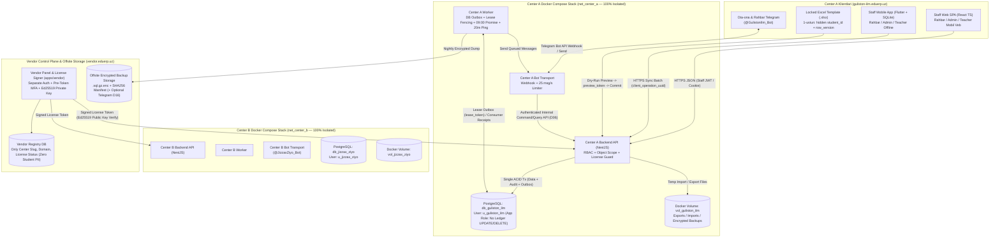
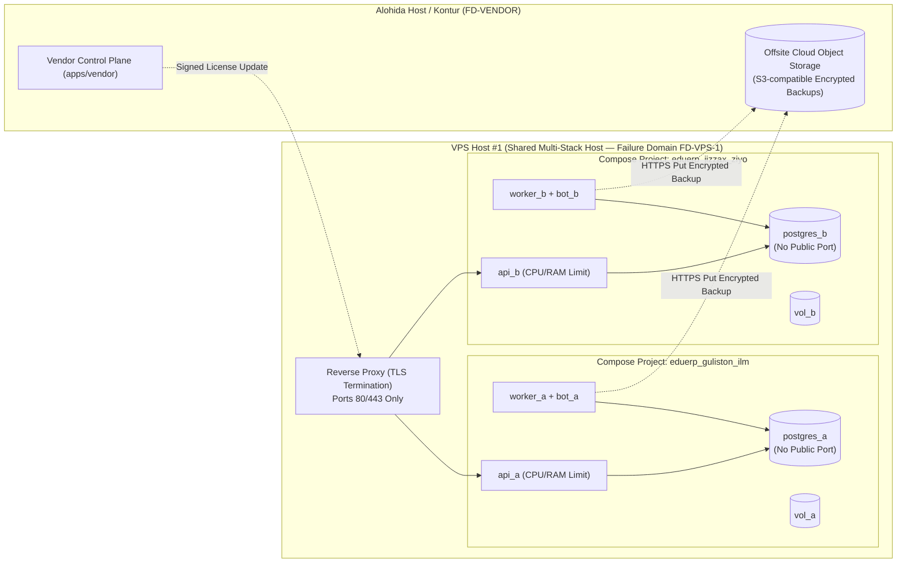

# EduERP v2.0 — Tizim Arxitekturasi, Markazlararo Izolyatsiya va Tranzaksiya Chegaralari (`docs/architecture/system.md`)

- **Task / Step ID:** `S02FIX-S03FULL-E` / Step `02.01` (`T02.01` — `S2F01`..`S2F07` tuzatishlari bilan yangilangan tahrir)
- **Base Commit:** `4a9ba11baf08460579d80f262b5c65b6ad64a6d1`
- **Asosiy manbalar:** `PDF p.1–3, 5–7` (`planning/source/MASTER_SOURCE_TEXT.md`), `planning/03_ARCHITECTURE.md`, `planning/05_DOMAIN_RULES.md`, `planning/07_SECURITY_AND_RELEASE.md`, `docs/spec/scope.md`, `docs/spec/business-rules.md`, `docs/spec/decisions.md`, `planning/state/reviews/S01-S02-D.md`.
- **Hujjat maqomi:** `IN_REVIEW` (Stage 02 arxitektura loyihasi. PostgreSQL, Docker Compose, per-center DB/domain/bot izolyatsiyasi va 100% Staff-Only kanal — `PDF_REQUIREMENT`; NestJS, Prisma, React, Flutter/SQLite, transactional outbox va `UZS scale=0` — `ENGINEERING_PROPOSAL`; ochiq siyosatlar `D01`–`D25` va `OPEN_*` moslashuvchan policy portlar hamda `DENY_UNTIL_POLICY_CONFIRMED` qoidasi sifatida loyihalashtirilgan).

---

## 1. Umumiy Tizim Arxitekturasi va 4-Tomonlama + Vendor Konturi

EduERP v2.0 B2B Turnkey platformasi ikkita qat’iy ajratilgan boshqaruv tekisligidan (**Plane**) iborat:
1. **Markaz Ishchi Konturi (`Center Data Plane` — har bir o‘quv markazi uchun 100% izolyatsiyalangan stack):** Har bir mijoz o‘quv markazi (masalan, `Center A: guliston-ilm` va `Center B: jizzax-ziyo`) o‘zining alohida PostgreSQL bazasi, alohida DB foydalanuvchisi, alohida fayl volume’i, alohida Backend API, alohida Outbox/Scheduler Worker, alohida Telegram Bot tokeni va alohida Docker bridge tarmog‘iga ega (`PDF p.1, 3`, `R02`, `T02.01`). Center Data Plane faqat `https://{center_slug}.eduerp.uz` serveriga bog‘lanadi (`S2F05`).
2. **Markaziy Vendor Boshqaruv Konturi (`Vendor Control Plane` — `apps/vendor`):** Platforma egasi (Vendor) uchun alohida server (`https://vendor.eduerp.uz`) va alohida autentifikatsiya (`Vendor Auth + Pre-Token TOTP MFA` — `D23`, `S2F01`, `S2F05`) bilan himoyalangan litsenziya va markazlar reestri. Vendor paneli o‘quv markazlarining ichki ta’lim yoki moliya ma’lumotlarini (o‘quvchilar, to‘lovlar, telefon raqamlar) **saqlamaydi va o‘qimaydi** (`03_ARCHITECTURE.md`, `T19.01`).

### 1.1. Tizim Komponentlari va Ma’lumot Oqimlari (`Mermaid System Context Diagram`)

---

## 2. Center A va Center B Izolyatsiya Chegaralari hamda Shared VPS Nosozlik Domeni (`T02.01`)

### 2.1. Markazlararo (`Center A` vs `Center B`) Qat’iy Chegaralar Jadvali

| Izolyatsiya qatlami | Center A (`guliston-ilm`) | Center B (`jizzax-ziyo`) | Izolyatsiya va Xavfsizlik Kafolati |
| :--- | :--- | :--- | :--- |
| **Domen va TLS** | `guliston-ilm.eduerp.uz` | `jizzax-ziyo.eduerp.uz` | Reverse proxy (Caddy/Nginx) `Host` sarlavhasi va SNI bo‘yicha faqat mos markazning ichki API portiga yo‘naltiradi; `center_slug` va `center_id` JWT hamda sessiya ichiga muhrlanadi (`T20.04`). |
| **Docker Tarmog‘i (`Network`)** | `net_guliston_ilm` (`internal bridge`) | `net_jizzax_ziyo` (`internal bridge`) | `net_guliston_ilm` ichidagi konteynerlar `net_jizzax_ziyo` dagi DB yoki API ga tarmoq paketini uzata olmaydi (`icc: false` across stacks — `T20.01`). |
| **PostgreSQL Bazasi va Credentials** | DB: `db_guliston_ilm` Runtime user: `app_guliston_ilm` Migrator: `mig_guliston_ilm` | DB: `db_jizzax_ziyo` Runtime user: `app_jizzax_ziyo` Migrator: `mig_jizzax_ziyo` | Har bir markaz alohida PostgreSQL konteyneri (yoki qat’iy ajratilgan DB + alohida parolli user) oladi; DB porti (`5432`) internetga (`0.0.0.0`) hech qachon ochilmaydi (`T03.03`, `T20.01`). |
| **Fayl Tizimi (`Storage Volume`)** | `/var/lib/eduerp/centers/guliston-ilm/` (`vol_guliston_ilm`, quota: `10 GB`) | `/var/lib/eduerp/centers/jizzax-ziyo/` (`vol_jizzax_ziyo`, quota: `10 GB`) | Har bir markaz konteyneri faqat o‘z volume’ini mount qiladi; Excel upload (`<= 5 MB`) va backup fayllar boshqa markazga ko‘rinmaydi. |
| **Telegram Bot va Webhook Secret** | `@GulistonIlm_Bot` Webhook: `/api/v1/bot/webhook/guliston-ilm` + `X-Telegram-Bot-Api-Secret-Token: sec_A` | `@JizzaxZiyo_Bot` Webhook: `/api/v1/bot/webhook/jizzax-ziyo` + `X-Telegram-Bot-Api-Secret-Token: sec_B` | Har bir bot tokeni faqat o‘z markazi stackiga beriladi; Center A botidan Center B talabasi haqida ma’lumot so‘rab bo‘lmaydi (`T14.04`, `T20.04`). |
| **Shifrlash va Imzo Kalitlari** | `JWT_SECRET_A`, `BACKUP_ENC_KEY_A` | `JWT_SECRET_B`, `BACKUP_ENC_KEY_B` | Center A da chiqarilgan JWT token yoki Excel `preview_token` Center B API sida kriptografik tekshiruvdan o‘tmaydi (`401`/`403` — `T23.03`). |

### 2.2. Deployment Topologiyasi va Shared VPS Nosozlik Domeni (`Shared VPS Failure Domain`)

- **Shared VPS Nosozlik Domeni Chegarasi (`03_ARCHITECTURE.md`, `T02.01`):**
  1. Tejamkorlik maqsadida bitta jismoniy VPS serverda bir nechta o‘quv markazining Docker Compose stacklari (`Stack A`, `Stack B`) ishlashi mumkin (`PDF p.1`).
  2. **Mantiqiy va Ma’lumot izolyatsiyasi to‘liq:** Konteynerlar, tarmoqlar, DB parollar va volume’lar alohida bo‘lgani uchun bitta markazdagi dasturiy xato yoki RBAC urinishi boshqa markazga o‘tmaydi. Resurs ochko‘zligi (`noisy neighbor`) oldini olish uchun har bir stackka Docker `mem_limit`, `cpus` va disk kvotasi qo‘yiladi (`T20.01`).
  3. **Umumiy jismoniy nosozlik domeni (`Shared Hardware/OS Failure Domain`):** Agar VPS Host #1 da disk to‘lib qolsa, OS yadrosi qulasa, elektr/tarmoq uzilsa yoki host root darajasida buzilsa, **shu VPS dagi barcha markaz stacklari bir vaqtda to‘xtaydi**.
  4. **Mitigatsiya:** Tungi shifrlangan zaxiralar (`BR-17`) ayni VPS da emas, balki **alohida Offsite Cloud Storage** da saqlanadi (`T21.01`). Yirikroq yoki alohida SLA talab qiluvchi o‘quv markazi uchun `deploy_center.sh` hech qanday kod o‘zgarishisiz **alohida Dedicated VPS** ga o‘rnatiladi (`03_ARCHITECTURE.md`).

---

## 3. Yagona Haqiqat Manbai, Tranzaksiya, Xavfsizlik va Siyosat Chegaralari

### 3.1. Yagona Haqiqat Manbai (`Single DB Truth`), Mutable So‘rov vs Immutable Ijro va Atomik Tranzaksiya Chegaralari (`S2F03`)
1. **Markaziy PostgreSQL — Yagona Haqiqat Manbai (`PDF p.5`):**
   - Web SPA, Flutter mobil ilovasi (SQLite), Excel shablon va Telegram bot o‘zicha balansni yoki qarzni hisoblab tasdiqlamaydi. O‘quvchi qarzi har doim serverdagi `Invoice`, `PaymentAllocation`, `PaymentAllocationReversal`, `CreditNote` va `CreditNoteApplication` yozuvlaridan aniqlanadi; agar tezlik uchun balans keshi (`balance_projection`) ishlatilsa ham, u faqat qayta tiklanadigan proyeksiya hisoblanadi (`05_DOMAIN_RULES.md`).
2. **Mutable So‘rov/Tasdiq va Append-Only Moliyaviy Ijro Ajratilishi (`S2F03`):**
   - O‘zgaruvchan ish jarayoni jadvallari (`discount_requests`, `reversal_or_refund_requests`) optimistik versiyalash (`version`) bilan yangilanadi (`PENDING_* -> APPROVED / REJECTED`).
   - Haqiqiy moliyaviy harakat va kompensatsiya jadvallari (`payments`, `payment_allocations`, `payment_allocation_reversals`, `reversal_or_refund_executions`, `credit_notes`, `credit_note_applications`, `receipts`, `cash_expenses`, `ledger_entries`) **qat’iy `append-only` (`REVOKE UPDATE, DELETE, TRUNCATE`)** bo‘lib, hech qachon `UPDATE` qilinmaydi.
   - `ledger_entries` jadvalida `actor_type IN ('STAFF', 'SYSTEM_WORKER')` va mos ravishda `actor_staff_id` (xodim amallari uchun) yoki `system_job_name` (rejalashtirilgan billing/worker amallari uchun) saqlanadi; tizim ishini yozish uchun soxta Director foydalanuvchisi yaratilmaydi (`S2F03`).
3. **Atomik DB Tranzaksiya Chegaralari (`ACID Transaction Boundaries` — `B03`, `T04.03`, `T10.01`, `T11.03`):**
   - **To‘lov va Va’da Sanasi Tranzaksiyasi (`RecordPaymentTx`):** Quyidagi amallar **bitta PostgreSQL `SERIALIZABLE` / `READ COMMITTED + Row Lock` tranzaksiyasida** bajariladi:
     1. `ClientOperationLog` tekshirish va band qilish (`(center_id, actor_id, idempotency_key)` + `request_body_sha256`; agar shu key boshqa body bilan kelsa `409 IDEMPOTENCY_PAYLOAD_MISMATCH`);
     2. Naqd to‘lov bo‘lsa `CashShift` statusi `OPEN` ekanini tekshirish (`SELECT ... FOR SHARE`; yopiq bo‘lsa `409 SHIFT_CLOSED`);
     3. `Payment` (`PositiveMoneyUzs > 0`) va `LedgerEntry` (`append-only`, `actor_type='STAFF'`) yozish;
     4. `Invoice` ustidan lock olib (`SELECT ... FOR UPDATE`), `PaymentAllocation` (va ortiqcha bo‘lsa `UnappliedCredit`) yozish;
     5. Agar to‘lovdan keyin `invoice.remaining_debt_uzs > 0` qolsa, majburiy `PromiseToPay` yozuvini yaratish (`promise_date` yo‘q bo‘lsa **butun tranzaksiya `ROLLBACK` bo‘ladi**, `Payment` ham saqlanmaydi — `B03`, `T11.03`); agar `remaining_debt_uzs == 0` bo‘lsa, mavjud ochiq `PromiseToPay` ni `FULFILLED`/`CANCELLED` qilish;
     6. `Receipt` (noyob kvitansiya raqami bilan), `AuditLog` va `OutboxEvent(PaymentRecorded)` yozish.
   - **Davomat Submit va Trial Faollashish Tranzaksiyasi (`SubmitAttendanceTx`):**
     1. O‘qituvchining shu `lesson_id` uchun joriy vakolatini (`group.primary_teacher_id == staff_id` yoki aktiv `SubstituteAssignment`) va markaz litsenziyasi `READ_ONLY` emasligini tekshirish;
     2. `ClientOperationLog` (`client_operation_uuid`), `AttendanceRecord` (`(lesson_id, student_id)`, `expected_version`) va `AttendanceRevision` ni yozish;
     3. `AuditLog` va `OutboxEvent(AttendanceSubmitted)` yozish;
     4. Agar `TRIAL` o‘quvchi 2-distinct darsda `PRESENT`/`LATE` bo‘lsa, `trial_activation_seq` bilan `TrialActivated` / `Invoice` yaratishni tetiklash (`BR-03`, `C04`).

### 3.2. Login Bootstrap, Sessiya Hayot Sikli, Obyekt Darajasidagi Vakolat (`Object-Scope RBAC`) va Maxfiylik (`S2F01`, `S2F02`, `S2F05`)
1. **Login Bootstrap va Aniq Public Allowlist (`S2F01`):**
   - Boshlang‘ich login operatsiyalari (`loginStaff`, `refreshStaffSession`, `loginVendorWithMfa`) va `getSystemHealth` oldindan Bearer token talab qilmaydi (`security: []`).
   - `loginStaff` (`POST /api/v1/auth/login`) `Host` sarlavhasidagi `center_slug` bo‘yicha markazni aniqlaydi, brute-force rate-limitni (`5 urinish / 15 daqiqa`) tekshiradi va `staff_users` parol xeshini tasdiqlagach `access_token` + `refresh_token` beradi.
   - `loginVendorWithMfa` (`POST /vendor/api/v1/auth/login`) `https://vendor.eduerp.uz` tekisligida vendor login/paroli bilan birga **6 xonali TOTP MFA kodini token berishdan oldin** tekshiradi va shundan keyingina `mfa_verified=true` da’voli `VendorMfaBearerAuth` JWT chiqaradi.
   - Sessiya hayot sikli `refreshStaffSession` (token rotatsiyasi va joriy `role`/`status` qayta tekshiruvi), `logoutStaffSession` (joriy sessiyani `revoked_at = NOW()` qilish) va `revokeStaffSessions` (xodimning barcha aktiv sessiyalarini majburiy bekor qilish — `T05.03`) operatsiyalari bilan to‘liq yopiladi.
2. **Har Bir Himoyalangan `GET` va `POST`/`PATCH` Uchun Obyekt Scope Tekshiruvi (`S2F02`):**
   - **Ishonchsiz Klient (`Zero Trust Client Input`):** `role`, `center_id` va `staff_id` faqat tekshirilgan sessiya/JWT tokenidan olinadi.
   - **Teacher Obyekt Izolyatsiyasi (`IDOR` himoyasi):** `getGroupSafeRoster`, `listCourseGroups`, `listGroupLessons`, `submitLessonAttendance`, `submitLessonGrades` va `syncOfflineAttendanceBatch` operatsiyalarida `TEACHER` roli faqat `course_groups.primary_teacher_id = :staff_id` yoki shu dars uchun aktiv `substitute_assignments.substitute_teacher_id = :staff_id` bo‘lgandagina ruxsat oladi. Teacher A boshqa Teacher B guruhining ro‘yxatini so‘rasa, `TeacherStudentView` DTO ichida telefon raqami bo‘lmasa ham, so‘rov **`403 FORBIDDEN_OBJECT_SCOPE`** bilan rad etiladi (`S2F02`).
   - **Ochiq RBAC Qarorlari Uchun `DENY_UNTIL_POLICY_CONFIRMED` Qoidasi (`S2F02`):** `OPEN_RBAC_01` (Adminning xodimlar ro‘yxatini o‘qishi) yoki `OPEN_RBAC_02` (Adminning moliyaviy/maosh/churn hisobotlarini o‘qishi) biznes egasi tomonidan tasdiqlanmaguncha, server default holatda faqat `DIRECTOR` ga ruxsat beradi va `ADMIN` so‘rovini `403 FORBIDDEN_ROLE` (`POLICY_DECISION_NOT_CONFIRMED`) bilan rad etadi.
   - **Guardian Bot va Vendor Chegaralari:** `getGuardianBalanceAndAttendanceForBot` faqat aktiv `guardian_telegram_links.telegram_chat_id` va `guardian_students.active = TRUE` bog‘lamasi bor farzandlarni qaytaradi; Vendor operatsiyalari esa faqat `https://vendor.eduerp.uz` dagi litsenziya reestriga murojaat qiladi (`S2F02`, `S2F05`).
3. **Teacher Telefon va Moliya Maxfiyligi (`F04`, `C05`, `T02.03`, `T05.04`):** Teacher uchun qaytadigan API DTO (`TeacherStudentView`), eksport, lokal SQLite jadvali va loglarda `guardian_phone`, `student_phone`, `invoice`, `debt`, `payment` maydonlari **fizik jihatdan mavjud emas**.

### 3.3. Valyuta (`UZS Scale=0` — `ENGINEERING_PROPOSAL`), BIGINT Chegarasi, Vaqt Mintaqasi va Siyosat Snapshotlari (`S2F07`)
- **Valyuta, Scale va Ishorali/Musbat Turlar (`C03`, `S2F07`):** Ichki baza va API da `currency = "UZS"`, `scale = 0` (`1 butun son = 1 so'm`, `ENGINEERING_PROPOSAL`) qo‘llanadi. OpenAPI 3.1 sxemasida pul qiymatlari PostgreSQL `BIGINT` (`1..18` xonali raqam) chegarasida to‘rtta aniq turga ajratiladi:
  1. `PositiveMoneyUzs` (`^[1-9][0-9]{0,17}$`, `> 0`) — to‘lov (`RecordPaymentCommand.amount_uzs`), storno/refund va fiks chegirma summalari uchun (`0` va manfiy qiymatlar sxema darajasida rad etiladi);
  2. `NonNegativeMoneyUzs` (`^(0|[1-9][0-9]{0,17})$`, `>= 0`) — tarif, hisoblangan net charge, qoldiq qarz, kredit va kassa balanslari uchun;
  3. `SignedMoneyDeltaUzs` (`^(0|-?[1-9][0-9]{0,17})$`) — kassa tafovuti (`discrepancy_uzs`) va jamlanma tuzatish deltalari uchun;
  4. `NonZeroSignedMoneyDeltaUzs` (`^-?[1-9][0-9]{0,17}$`, `!= 0`) — `PayrollAdjustment` va `CashExpense` yozuvlari uchun.
- **OpenAPI 3.1 Null Union vs Optional (`S2F07`):** OpenAPI 3.1 (JSON Schema 2020-12) da eskirgan `nullable: true` ishlatilmaydi; explicit `null` qabul qiluvchi maydonlar `type: [..., "null"]` yoki `anyOf: [{"$ref": "..."}, {"type": "null"}]` orqali ifodalanadi va `required` ro‘yxatidan tashqaridagi `optional` maydonlardan qat’iy farqlanadi.
- **Vaqt mintaqasi va Siyosat Snapshotlari:** DB da barcha `TIMESTAMPTZ` ustunlari `UTC` da; biznes sanalari markazning `center.timezone` (`Asia/Tashkent`) mintaqasida hisoblanadi. Har bir `Invoice`, `DiscountApproval`, `FreezeRecord` va `PayrollSnapshot` yaratilgan vaqtdagi `policy_version_id` va `price_snapshot_uzs` ni o‘zida muhrlaydi (`05_DOMAIN_RULES.md`).

### 3.4. Outbox Lease Fencing, Consumer Receipt Dedup, Tartib (`Ordering`), Restore va Litsenziya (`S2F04`)
- **Transactional Outbox, Lease Fencing (`lease_token`), Tartib va Consumer Dedup (`S2F04`, `T13.01`):**
  1. **Lease Fencing:** Worker `outbox_events` yozuvini band qilganda `lease_token = lease_token + 1` oshiriladi; ACK yoki holat o‘zgarishi faqat `WHERE id = :id AND lease_token = :worker_lease_token` mos kelsagina qabul qilinadi (kechikkan/muddati o‘tgan worker ACK’i rad etiladi).
  2. **Per-Aggregate Ordering:** Lease so‘rovi ayni `(center_id, aggregate_type, aggregate_id)` bo‘yicha kichikroq `aggregate_version` hali `PENDING`/`LEASED`/`DEAD_LETTER` bo‘lsa keyingi versiyani bermaydi (`predecessor gate`).
  3. **Atomic Consumer Receipt (`outbox_consumer_receipts`):** Producer `dedup_key` faqat hodisa yozilishini dedup qiladi; har bir ichki DB consumer esa o‘z domen o‘zgarishi bilan bitta DB tranzaksiyasida `outbox_consumer_receipts (center_id, consumer_name, outbox_event_id)` yozuvini kiritadi. Fanout xabarlar esa `notification_deliveries (outbox_event_id, recipient_type, recipient_id)` orqali har bir qabul qiluvchi kesimida alohida kuzatiladi.
- **Restore Vaqtida `BOT_OUTBOUND_ENABLED = false` (`B14`, `BR-17`, `T21.02`):** Zaxiradan tiklash (restore) jarayonida eski outbox xabarlari ota-onalarga qayta ketib qolmasligi uchun worker outbound jo‘natish o‘chirilgan holatda ishga tushadi va outbox reconciliation bajariladi.
- **Litsenziya Kill-Switch (`BR-15`, `D17`, `D23`, `T19.03`):** Markaz `READ_ONLY` holatiga o‘tganda API middleware va Worker darajasida barcha biznes yozish amallari `403 LICENSE_READ_ONLY_MODE` bilan bloklanadi; faqat `Allowlist` dagi tizim amallari (`login`, `refresh`, `logout`, `GET` read, `export`, `backup`, `license refresh`, `health`) ishlaydi.

---

## 4. Manba Talabi vs Muhandislik Taklifi vs Ochiq Foydalanuvchi Qarorlari Farqi

| Arxitektura qarori / komponenti | Tasnifi (`Classification`) | Asos va Izoh |
| :--- | :---: | :--- |
| **PostgreSQL, Docker Compose, Staff-Only kanal, Parent Telegram Bot, Locked Excel (`student_id`), SQLite Offline, Vendor Read-Only Kill-Switch** | **`PDF_REQUIREMENT`** | Manba PDF (`1–8-sahifalar`) da bevosita talab qilingan arxitektura ustunlari. |
| **NestJS, Prisma, React TS, Flutter, OpenAPI 3.1, Transactional Outbox + `lease_token` + `OutboxConsumerReceipt`, `(lesson_id, student_id)` kaliti (`D07`), Bot Command API (`D06`), Runtime DB role `REVOKE UPDATE/DELETE` (`D08`), `UZS scale=0` (`C03`, `S2F07`)** | **`ENGINEERING_PROPOSAL`** | Manba maqsadlarini xavfsiz va poygalarsiz (race-free) bajarish uchun tanlangan texnik dizayn (`03_ARCHITECTURE.md`, `05_DOMAIN_RULES.md`). |
| **Tarif rejimlari (`D03`/`D21`), Payroll formulasi (`D11`), Click/Payme gateway (`D12`), Rounding/Stacking/Freeze basis (`D14`), Telegram backup (`D16`), Grace period (`D17`), Retention TTL (`D19`), Refund debt reopen (`D22`), Mobile OS (`D24`), Video kontent (`D25`), `OPEN_RBAC`/`OPEN_CHANNEL`/`OPEN_PRIVACY`** | **`USER_DECISION_REQUIRED` / `DEFERRED`** | Biznes egasi tasdig‘ini kutayotgan siyosatlar (`docs/spec/decisions.md`). Ular tizim arxitekturasida qattiq kodlanmasdan, `CenterPolicyConfig` portlari va `DENY_UNTIL_POLICY_CONFIRMED` darvozalari orqali boshqariladi. |
